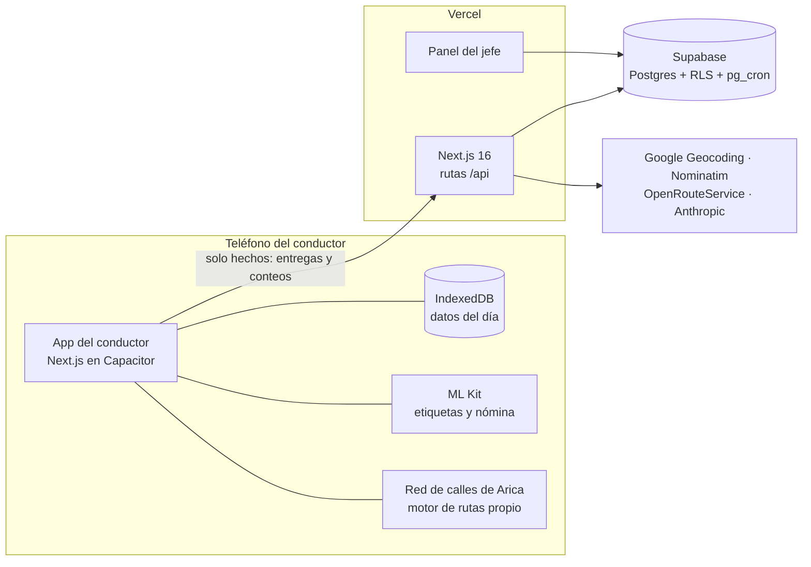

# ARES

Reparto de encomiendas de **Dashund** en Arica. ARES cumple el papel del pioneta: ubica cada
dirección, optimiza la ruta, ayuda a contactar al destinatario, registra cada entrega y le deja al
jefe los conteos con que se calcula el pago del día. La meta es entregar más en menos tiempo, con
pocos toques.

Son dos aplicaciones que comparten el backend, cada una con su propio diseño:

| | Para quién | Dónde corre |
|---|---|---|
| **App del conductor** | El conductor, en terreno | APK Android (Capacitor) o PWA, a 360 px y a pleno sol |
| **Panel** | El jefe | Navegador de escritorio |

## El día del conductor

| Paso | Qué hace ARES |
|---|---|
| 1. Cargar la guía | Lee la guía de despacho (fotos o nómina) y ubica cada dirección: Plus Code, catálogo de calles de Arica, buscadores y, para las dudosas, IA. |
| 2. Resolver advertencias | Marca con ⚠ lo que no se pudo ubicar o calza en más de un lugar, para resolverlo antes de salir. |
| 3. Optimizar la ruta | Ordena las paradas sobre la red de calles de Arica, respetando sentidos de tránsito y la entrada de cada condominio, sin conexión ni cuota. |
| 4. Cargar el vehículo | Escanea cada etiqueta (ML Kit, en el teléfono): dice en qué parada va y completa nombre, teléfono y POR PAGAR. |
| 5. Recorrer | Google Maps guía con la burbuja de ARES encima; llamar es un toque y cada parada se cierra como entregada o no entregada. |
| 6. Cerrar el día | Lista lo no entregado, borra los datos del día del teléfono y envía los conteos al panel. |

## Arquitectura



- **Los datos de los destinatarios no salen del teléfono.** Nombre, teléfono, dirección, OF y
  fotos viven en IndexedDB y se borran al cerrar el día; al servidor sube solo el hecho de cada
  entrega. Detalle y proveedores en [`docs/PRIVACIDAD.md`](docs/PRIVACIDAD.md).
- **Funciona sin conexión.** Ubicar con Plus Code, optimizar la ruta y registrar entregas no
  dependen de la red; lo pendiente queda en una cola que se envía al volver la conexión.
- **Costo cero por defecto.** Cada proveedor de pago tiene una cuota que lo deja en US$0;
  OpenRouteService queda como respaldo del motor de rutas propio.

## Stack

| Capa | Tecnología |
|---|---|
| Web | Next.js 16 (App Router) · React 19 · TypeScript estricto · Tailwind 4 |
| Datos | Supabase (Postgres, RLS, `pg_cron`) · IndexedDB en el teléfono |
| Mapa | MapLibre + OpenFreeMap |
| Android | Capacitor 8 · plugins propios (`Telefono`, `Burbuja`, `EscanerVivo`) · ML Kit |
| Publicación | Vercel (cada push a `main`) · APK firmada por GitHub Actions |
| Pruebas | `node:test`, sin framework |

## Empezar

Requiere Node.js 24.

```bash
npm install
cp .env.example .env.local   # Supabase y las claves de los proveedores
npm run dev                  # http://localhost:3000
```

Para probar en un teléfono hace falta HTTPS (`npx ngrok http 3000`). La APK de desarrollo
contra el PC se compila con la skill `apk-local` (`.agents/skills/apk-local/`).

| Comando | Para qué |
|---|---|
| `npm run dev` / `build` / `start` | Desarrollo, compilación y servidor de producción |
| `npm run lint` | ESLint de Next |
| `npm test` | Todas las pruebas, sin red ni base de datos (~40 s) |
| `npm run test:base` | Cálculo del pago contra la base real (solo lectura) |
| `npm run test:esquema` | Que cada campo de `src/types/db.ts` exista en la base |
| `npm run red` | Regenera la red de calles de Arica desde OpenStreetMap |
| `npm run calles` | Regenera el catálogo de calles de Arica |
| `npm run medir` | Mide el armado de rutas sobre un día de prueba (sin red ni cuota) |
| `npm run medir:direcciones` | Mide cargar la guía (crear, ubicar y corregir con IA) con proveedores simulados, sin red ni cuota |
| `npm run sondear` | Mide los buscadores de direcciones (**gasta cuota**: 27 consultas a Google y 27 a ORS) |
| `npm run mcp` | Servidor MCP con herramientas geográficas (Plus Code, rutas) |

## Estructura

```text
src/
├── app/(conductor)/   app del conductor: pantalla, componentes, hooks y mapa
├── app/(app)/         panel del jefe
├── app/api/           rutas del servidor (lectura de guía, geocodificación, IA, WhatsApp)
├── components/        UI compartida (ui/, direccion/, panel/, marca/)
└── lib/               una carpeta por dominio: encomiendas, geo, rutas, nativo, auth…
android/               proyecto Android (Capacitor) y plugins nativos
supabase/migrations/   SQL re-ejecutable, cada migración con su verificación
pruebas/               pruebas con node:test
specs/                 features pendientes, una carpeta por feature (Spec Kit)
docs/                  arquitectura, clases, hoja de ruta, privacidad, WhatsApp
```

## Documentación

| Documento | Contenido |
|---|---|
| [`AGENTS.md`](AGENTS.md) | Cómo se trabaja en el repo: flujo del conductor, convenciones, reglas del dominio y verificación |
| [`docs/ARQUITECTURA.md`](docs/ARQUITECTURA.md) | Límites del sistema, tablas, stores del teléfono y cómo viaja cada dato |
| [`docs/CLASES.md`](docs/CLASES.md) | Glosario, tipos, estados y en qué archivo está cada cosa |
| [`docs/HOJA-DE-RUTA.md`](docs/HOJA-DE-RUTA.md) | Lo hecho, lo medido y lo que sigue |
| [`docs/PRIVACIDAD.md`](docs/PRIVACIDAD.md) | Qué dato va a dónde y qué proveedor lo recibe (Ley 21.719) |
| [`specs/README.md`](specs/README.md) | Índice de features pendientes y cómo se trabaja por ramas |

## Ramas y publicación

- `main` es producción: Vercel publica cada push y la APK carga la versión publicada.
- Cada feature se desarrolla en su rama (`NNN-nombre`, como su carpeta en `specs/`) y vuelve a
  `main` con `git merge --no-ff` cuando pasa la verificación.
- La APK se publica con un tag `apk-vX.Y.Z`; la firma y sus secretos están en
  [`specs/015-app-android/quickstart.md`](specs/015-app-android/quickstart.md). Solo hace falta
  reinstalarla cuando cambia `android/`.
- Las migraciones de `supabase/migrations/` se corren en orden (detalle en
  [`docs/ARQUITECTURA.md`](docs/ARQUITECTURA.md) §2).
