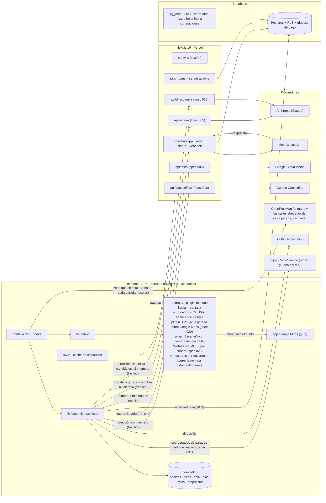
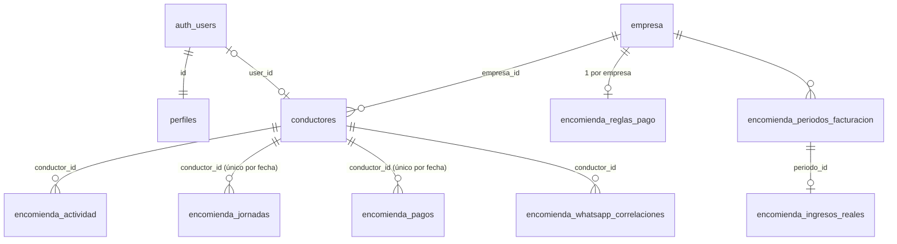
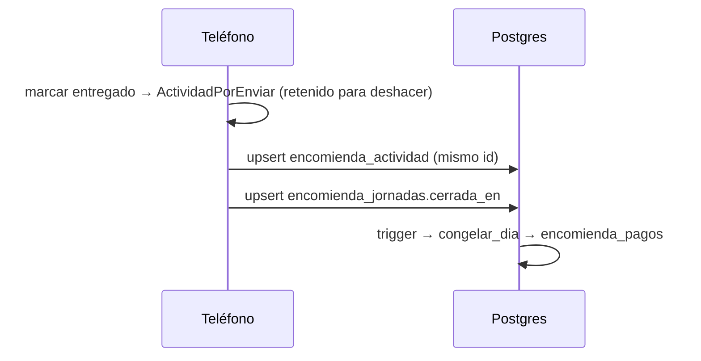
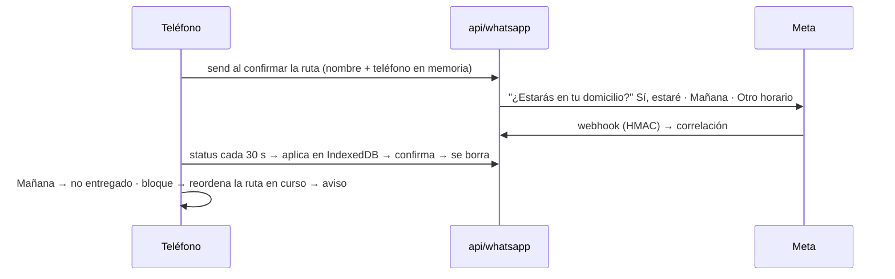

# Arquitectura

Fuente canónica de límites, datos, acceso y carpetas (constitución VI). Tipos y
módulos en detalle: `docs/CLASES.md`; producto y reglas: `AGENTS.md`. Estado: código al 2026-10-24 (specs 008 a 013; APK de la 015 en curso).

## 1. Sistema



Regla: datos de destinatarios solo en el teléfono; al servidor sube el hecho
(`encomienda_actividad`). La foto de la etiqueta (nombre y teléfono) se lee con ML Kit en el
teléfono y no tiene flecha hacia afuera (spec 021). Ver `docs/PRIVACIDAD.md`.

**Direcciones (spec 016 y 019).** `ubicarDireccion` limpia el texto, consulta Google (solo con
número, por `/api/geocodificar`) y Nominatim y, sin puerta, vuelve a preguntar a Google con el
nombre oficial de la calle, corregido con un
catálogo de calles de Arica que viaja en el código (`geo/geocoding/calles-arica.ts`, generado
de OpenStreetMap con `npm run calles`; Overpass solo recibe el recuadro). Flujo:
`specs/016-ubicar-direcciones/plan.md`.

**APK (spec 015).** Capacitor abre la web publicada (`capacitor.config.ts`, `server.url` =
`…vercel.app/conductor`): cada deploy le llega solo. Lo nativo está en `android/` (plugin propio
`Telefono`, `Burbuja` y `EscanerVivo` en Java, y el escáner de Google, ML Kit) y la web lo usa solo a través de
`src/lib/nativo/`, que fuera de la APK cae a lo de la web (`tel:`,
Screen Wake Lock, Google Maps por enlace). ARES no guía (spec 020): los km de la parada abren la
app Google Maps y encima queda la burbuja (`BurbujaServicio`, servicio en primer plano
`specialUse` con una ventana sobre otras apps), que dibuja la vista que manda la web y le devuelve
cada toque. Navegando va achicada y se abre sola al llegar a la parada: escucha la ubicación pasiva
que ya pide Google Maps (`BurbujaLlegada`, tipo `location`, solo mientras está en curso). Con la
burbuja en curso, `WebViewAres` impide que la WebView congele la página atrás (la 156 la congela al
minuto y los toques no se guardaban); la web lo atiende con las mismas funciones de la tarjeta (`botones-parada.ts`).
Contrato: `specs/020-burbuja-google-maps/contracts/burbuja.md`.
`public/sw.js` guarda páginas y estáticos de `/conductor` (red primero, caché
sin señal) para abrir la ruta en modo avión; sin nada guardado se ve
`capacitor/www/sin-senal.html`. Reinstalar hace falta solo si cambia `android/`; entonces
`APK_VERSION_MINIMA` y `APK_URL` (Vercel) hacen que la app lo avise.

## 2. Datos

### Servidor (Postgres, `supabase/migrations/0001–0007`; 0006 renombra a conductor y 0007 agrega los indicadores, 2026-10-25)



Las tablas conservan sus nombres hasta la spec 002 (US2); en el código ya tienen el del glosario:

| Tabla | Tipo |
|---|---|
| `conductores` · `perfiles` · `empresa` | `Conductor` · `Perfil` · `Empresa` |
| `encomienda_jornadas` | `DiaTrabajo` (+ `asignados`, `contactados` que manda el teléfono, 0007) |
| `encomienda_actividad` | `Actividad` |
| `encomienda_pagos` | `PagoDelDia` (con `TarifaDelDia`) |
| `encomienda_reglas_pago` | `ReglaDePago` |
| `encomienda_whatsapp_correlaciones` | `Aviso` (copia temporal del aviso) |
| `encomienda_periodos_facturacion` · `encomienda_ingresos_reales` | `PeriodoFacturacion` · `IngresoReal` |

Campos completos: `src/types/db.ts` (tipo `Database`, el que usan los clientes de Supabase);
vista esencial: `docs/CLASES.md` §1. Todas llevan `empresa_id` (trigger
`set_empresa_id()`) y RLS.

| Lógica en la base | Qué hace |
|---|---|
| `private.encomienda_congelar_dia()` + triggers en actividad y días | al cerrar el día, calcula el día y lo escribe en `encomienda_pagos` con la tarifa vigente |
| `encomienda_repreciar_dia()` / `encomienda_valorar_dia()` | cambiar la tarifa de un día ya congelado, uno a uno |
| cron 00:30 | cierra días olvidados |
| cron horario + trigger de cierre | borra correlaciones de WhatsApp (cierre, aplicada o 72 h) |

`src/lib/encomiendas/pago.ts` copia la aritmética solo para la vista previa
(`pruebas/base.mjs` verifica que coincidan).

Migraciones: 0001 base (empresa, perfiles y roles, conductores, storage) · 0002 encomiendas y
cálculo del pago · 0003 bloques horarios y correlaciones de WhatsApp (y el `motivo` heredado) ·
0004 botón "Mañana" · 0005 recalcular o valorar un día solo con rol de jefe · 0006 "chofer" →
"conductor" · 0007 indicadores. Se corren en orden (SQL Editor o MCP de Supabase), son
re-ejecutables, terminan en un `select` de verificación (todo `true`) y requieren `pg_cron` y
`btree_gist`.

**Acceso.** Roles: `admin` (todo; el primer usuario registrado), `operador` (todo menos crear
cuentas) y `conductor` (su ruta y sus cifras; se invita desde Conductores → "Invitar"). El panel
es solo para `admin`/`operador` y la app solo para `conductor`; RLS repite la regla.

| Dato | Conductor | Jefe / operador |
|---|---|---|
| Nombre, teléfono, dirección, orden de ruta | solo los suyos, en su teléfono, durante el día | no existen en el servidor |
| Conteos de entregadas y no entregadas | los suyos | de todos |
| Reglas de pago, bonos y bloques horarios | los lee | los configura |

### Teléfono (IndexedDB `dashund-encomiendas` v6)

| Store | Clave | Contenido | Relación |
|---|---|---|---|
| `pedidos` | `id` | `Pedido`: destinatario, OF y referencia del paquete, llamada, resultado de la visita, su `aviso` de WhatsApp y sus ⚠ guardados (`problemas`, opcional, spec 022: incluye las opciones de lugar de una dirección en duda); `fecha` = su día | `aviso.codigo` ↔ `encomienda_whatsapp_correlaciones` |
| `rutas` | `fecha` | `Ruta`: `orden` de visita + trazado (cerrado: vuelve a `partida`) + `tramos` (dónde empieza y termina cada parada en el trazado; opcional, spec 020) + `inicioReparto` (cuándo salió a repartir; opcional, spec 027, no sale del teléfono) | `orden[]` → pedidos |
| `cola` | `id` | `ActividadPorEnviar` | `id` = `encomienda_actividad.id` (sin duplicados) |
| `fotos` | `id` (índice `por_fecha`) | `Foto` del paquete, JPEG ≤ 1280 px (spec 003) | `Pedido.fotoId`; se borra al cerrarse el pedido y con el día |
| `propuestas` | `fecha` | `PropuestaGuardada`: la ruta propuesta a la vista y sin aceptar (v6, dueño 2026-11-09), con las paradas como id y punto, el trazado y los avisos; vuelve sola al abrir si los pendientes no cambiaron (`generar-ruta/propuesta-guardada.ts`) | paradas → pedidos; se borra al usarla o descartarla y con el día |
| `dias` | `fecha` | `ResumenDia`: solo cifras de un día ya borrado (spec 007): entregas, cobros sumados y pedidos por origen de carga (005), sin datos de destinatarios | inicio y cierre → `encomienda_jornadas` si la ruta ya no está |

Formas en `local/almacen/tipos.ts`; `idb.ts` (`FilaDe`) tipa cada store y solo `almacen/` lo usa.
v3 (specs 009 y 011) fundió la parada y el aviso en el pedido y renombró los campos al glosario
(`docs/CLASES.md` §0): la migración corre al abrir, en la transacción de versión
(`almacen/migrar.ts`).

El nombre de la base no se cambia (dejaría huérfanos los datos). Un pedido es de un solo día:
lo no entregado se tacha y no pasa al siguiente; si vuelve a salir, se escanea de nuevo (specs 009 y 012).

**Borrado (spec 007, `almacen/borrado.ts`).** Al cerrarse el día el conductor ve "No entregados"
y confirma: en una transacción se escribe el `ResumenDia` y se borran pedidos y ruta de esa fecha
(`STORES_DEL_DIA`). Un día anterior que quedó con datos se muestra y borra al abrir la app, antes
del día nuevo. Cerrar sesión borra todo (con aviso), y también una cuenta sin ficha o desactivada,
pero solo cuando el servidor lo confirmó: un error de red nunca borra. La `cola` no se toca.

## 3. Flujos

El día del conductor, paso a paso: `AGENTS.md`, "El flujo del conductor". Abajo, cómo viajan los
datos en dos de esos pasos.

Armar la ruta (spec 031) no sale del teléfono: paradas → red de calles propia (`geo/red/`, un archivo
generado de OpenStreetMap que queda guardado por el service worker) → matriz con rumbo → orden y
sentido de paso → trazado. ORS queda de respaldo, detrás de `geo/ruta-por-calles.ts` y de
`generar-ruta/red-del-dia.ts`.





**Propuestas de ruta:** una por defecto; alternativas ("La más corta", "Respeta horarios",
"Confirmados primero") solo si cambian de verdad el tiempo, la distancia, lo que se alcanza a
entregar o el cumplimiento de los bloques, con un máximo de tres. Generar siempre tres
multiplicaría las consultas de trazado y le haría elegir al conductor entre opciones iguales.

## 4. Carpetas (actuales)

```text
src/
├── proxy.ts                      sesión Supabase por request (lib/supabase/sesion-proxy)
├── app/(app)/                    panel: encomiendas (dia/_componentes) · conductores (_componentes) · configuracion · @modal
├── app/(conductor)/conductor/    PWA y APK: encomiendas (pantalla, que solo une · _componentes: parada activa, carril, hoja, ventanas · _hooks: hacia la parada (km y aviso de 300 m por el tramo de la línea del día), botones de la parada (los de la tarjeta y la burbuja), burbuja, acciones de la parada, propuesta, botón atrás · _mapa: ruta-mapa (MapLibre + OpenFreeMap, spec 019), estilo, cámara, marcadores, capa-paradas: las paradas dibujadas por el mapa —WebGL—, no como elementos de la página) · diagnostico (APK)
├── app/(conductor)/tema-dashund  el tema de la app del conductor (diseño "Plano" con el naranja de Dashund, Manrope + IBM Plex Mono); solo lo carga el layout del conductor
├── components/marca/logo-dashund  el logo de Dashund (cara de perro salchicha): inicio de sesión, menú, pantalla de carga; public/dashund.svg es el mismo dibujo y de ahí salen los íconos (scripts/generar-iconos.mjs)
├── components/ui/campo           la caja de texto del conductor: la etiqueta va adentro (52 px, 44 la compacta) y el estado en un renglón debajo; DireccionInput la usa cuando recibe `etiqueta`
├── app/api/                      whatsapp (send · status · webhook) · lectura (IA, solo la guía, spec 005 y 021) · geocodificar (Google, spec 016) · texto (Cloud Vision, la guía, spec 005)
├── components/                   ui (primitivas) · direccion (campo y vista previa: estampilla-mapa saca la foto del mapa y lo destruye, spec 019) · panel (marco del panel)
├── lib/                          una carpeta por dominio, sin archivos sueltos
│   ├── auth/                     sesion · roles · acciones (login/logout) · api-conductor · conductor-de-usuario
│   ├── supabase/                 server · client · admin · sesion-proxy
│   ├── comun/                    fechas · format · forms · utils · uuid · deslizar · telefono · periodo · periodo-servidor
│   ├── encomiendas/              catalogos · estados · pago · periodos · config · paquete · contrato-whatsapp · lectura/ (guía, etiqueta, código de barras)
│   │   └── local/                idb · almacen/ (lecturas, pedidos, ruta, terreno…) · generar-ruta/ (partida, ubicar-pedidos, red-del-dia, estrategias, horarios, pesos, avisos, cambiar-propuesta…) · planificar · replanificar · sumar-a-ruta · corregir-direcciones · enviar · sincronizar-whatsapp
│   ├── geo/                      coordenada · trazado · hacia-parada (km a la parada activa por su tramo, spec 020) · plus-code · openrouteservice (MCP) · estilo-mapa (OpenFreeMap "Liberty" con edificios planos y el worker de MapLibre, que copia scripts/copiar-worker-mapa.mjs a public/) · matriz (distancias por calle con ORS, por bloques, en memoria) · ors/ (cliente · direcciones: línea del día y sus tramos por parada, sin reversa en calles estrechas · vuelta: tipo de calle) · acceso (la calle por donde se llega a una parada pegada a una troncal) · teselas (las calles de las teselas de OpenFreeMap) · geocoding/ (consulta · calles · calles-arica generado · google · nominatim · sugerir · codigo · completar-numero · ubicar) · direccion-ia/ (contrato · servidor · cliente: corregir con IA, spec 018) · red/ (spec 031: red-arica generado · codigo · grafo · pegar · caminos · tiempos · matriz-con-rumbo · trazado-propio · medir) · ruta-por-calles (la puerta al trazado: la red propia y, si falta, ORS)
│   ├── rutas/orden-paradas/      exacto · construccion · mejora · perturbacion · descarga · con-horarios · sin-congelar · con-rumbo · con-rumbo-jugadas · con-rumbo-busqueda · descarga-con-rumbo (spec 031)
│   ├── whatsapp/                 meta · correlacion
│   ├── conductores/              vencimientos
│   └── nativo/                   entorno · telefono · llamada · escaner · escaner-vivo (cámara en vivo, spec 028) · version (APK) · mapas · burbuja (la parada sobre Google Maps, spec 020)
└── types/db.ts                   tablas + `Database` para supabase-js (valida pruebas/esquema.mjs)
public/sw.js                      caché de /conductor para abrir sin señal
capacitor.config.ts · capacitor/www/   APK: URL que abre · página sin señal
android/ · .github/workflows/apk.yml   proyecto Android y su build (AGENTS.md, "Comandos")
mcp/ · pruebas/ (658) · supabase/migrations/ (0001–0007) · specs/
```

Reglas de capas (A1–A10): `pruebas/arquitectura.test.mjs`. Estructura objetivo y lo que falta:
`specs/002-reestructuracion-codigo/plan.md`. Acceso por rol: §2, "Acceso".
