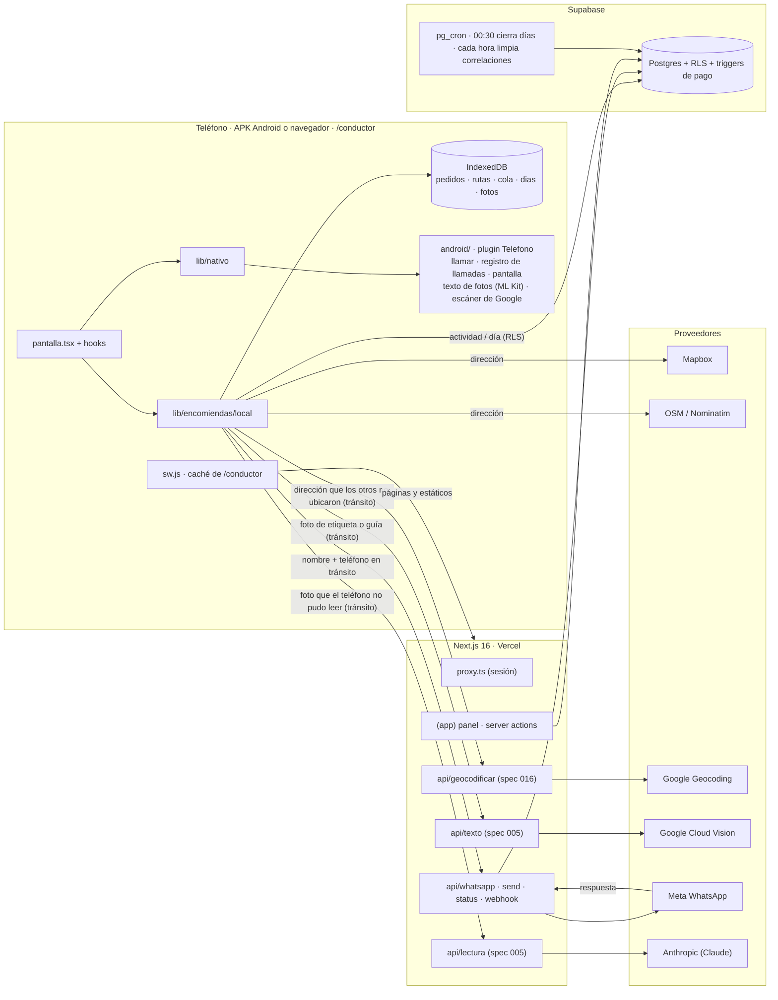
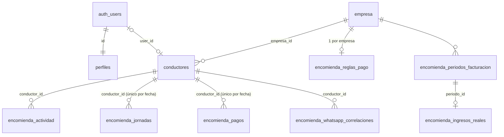
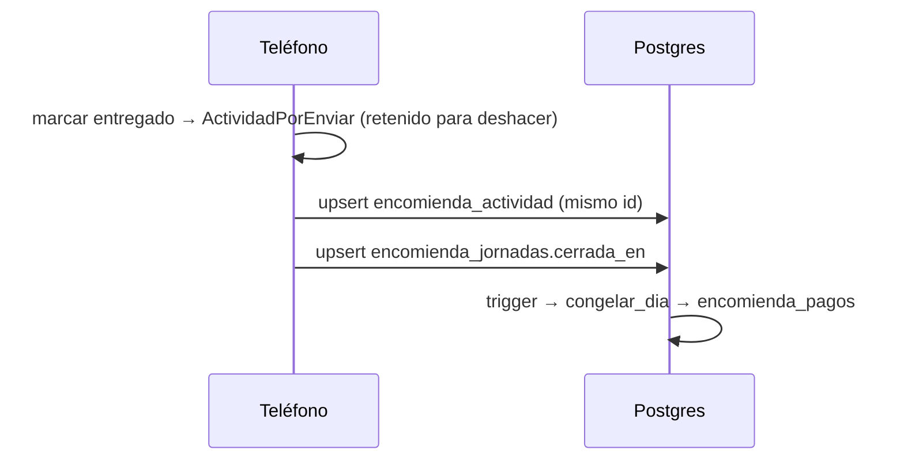
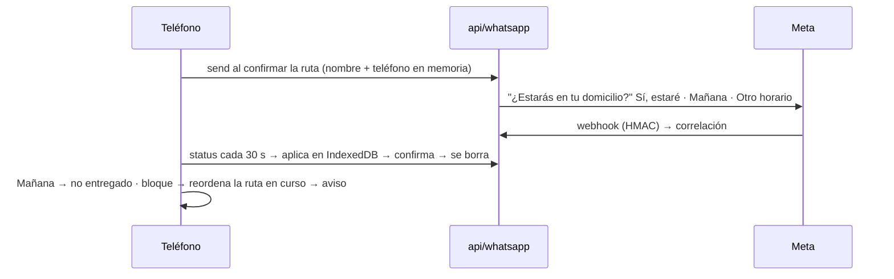

# Arquitectura

Fuente canónica de límites, datos y carpetas (constitución VI). Tipos y módulos en detalle:
`docs/CLASES.md`. Estado: código al 2026-10-24 (specs 008 a 013; APK de la 015 en curso).

## 1. Sistema



Regla: datos de destinatarios solo en el teléfono; al servidor sube el hecho
(`encomienda_actividad`). Ver `docs/PRIVACIDAD.md`.

**Direcciones (spec 016).** `ubicarDireccion` limpia el texto, consulta Mapbox y Nominatim y,
sin puerta, vuelve a preguntar a Mapbox con el nombre oficial de la calle, corregido con un
catálogo de calles de Arica que viaja en el código (`geo/geocoding/calles-arica.ts`, generado
de OpenStreetMap con `npm run calles`; Overpass solo recibe el recuadro). Flujo:
`specs/016-ubicar-direcciones/plan.md`.

**APK (spec 015).** Capacitor abre la web publicada (`capacitor.config.ts`, `server.url` =
`…vercel.app/conductor`): cada deploy le llega solo. Lo nativo está en `android/` (plugin propio
`Telefono` en Java y el escáner de Google, ML Kit) y la web lo usa solo a través de
`src/lib/nativo/`, que fuera de la APK cae a lo de la web (`tel:`, preguntar "¿Contestó?",
Screen Wake Lock). `public/sw.js` guarda páginas y estáticos de `/conductor` (red primero, caché
sin señal) para abrir la ruta en modo avión; sin nada guardado se ve
`capacitor/www/sin-senal.html`. Reinstalar hace falta solo si cambia `android/`; entonces
`APK_VERSION_MINIMA` y `APK_URL` (Vercel) hacen que la app lo avise.

## 2. Datos

### Servidor (Postgres, `supabase/migrations/0001–0007`; 0006 renombra a conductor y 0007 agrega los indicadores, 2026-10-25)



Las tablas conservan sus nombres hasta la spec 002 (US2); en el código ya tienen el del glosario:

| Tabla | Tipo |
|---|---|
| `conductores` · `perfiles` · `empresa` | `Conductor` · `Perfil` · `Empresa` |
| `encomienda_jornadas` | `DiaTrabajo` (+ `asignados`, `contactados` que manda el teléfono, 0007) |
| `encomienda_actividad` | `Actividad` |
| `encomienda_pagos` | `PagoDelDia` (con `TarifaDelDia`) |
| `encomienda_reglas_pago` | `ReglaDePago` |
| `encomienda_whatsapp_correlaciones` | `Aviso` (copia temporal del aviso) |
| `encomienda_periodos_facturacion` · `encomienda_ingresos_reales` | `PeriodoFacturacion` · `IngresoReal` |

Campos completos: `src/types/db.ts` (tipo `Database`, el que usan los clientes de Supabase);
vista esencial: `docs/CLASES.md` §1. Todas llevan `empresa_id` (trigger
`set_empresa_id()`) y RLS.

| Lógica en la base | Qué hace |
|---|---|
| `private.encomienda_congelar_dia()` + triggers en actividad y días | al cerrar el día, calcula el día y lo escribe en `encomienda_pagos` con la tarifa vigente |
| `encomienda_repreciar_dia()` / `encomienda_valorar_dia()` | cambiar la tarifa de un día ya congelado, uno a uno |
| cron 00:30 | cierra días olvidados |
| cron horario + trigger de cierre | borra correlaciones de WhatsApp (cierre, aplicada o 72 h) |

`src/lib/encomiendas/pago.ts` copia la aritmética solo para la vista previa
(`pruebas/base.mjs` verifica que coincidan).

### Teléfono (IndexedDB `pucarani-encomiendas` v5)

| Store | Clave | Contenido | Relación |
|---|---|---|---|
| `pedidos` | `id` | `Pedido`: destinatario, OF y referencia del paquete, llamada, resultado de la visita y su `aviso` de WhatsApp; `fecha` = su día | `aviso.codigo` ↔ `encomienda_whatsapp_correlaciones` |
| `rutas` | `fecha` | `Ruta`: `orden` de visita + trazado | `orden[]` → pedidos |
| `cola` | `id` | `ActividadPorEnviar` | `id` = `encomienda_actividad.id` (sin duplicados) |
| `fotos` | `id` (índice `por_fecha`) | `Foto` del paquete, JPEG ≤ 1280 px (spec 003) | `Pedido.fotoId`; se borra al cerrarse el pedido y con el día |
| `dias` | `fecha` | `ResumenDia`: solo cifras de un día ya borrado (spec 007): entregas, cobros sumados y pedidos por origen de carga (005), sin datos de destinatarios | inicio y cierre → `encomienda_jornadas` si la ruta ya no está |

Formas en `local/almacen/tipos.ts`; `idb.ts` (`FilaDe`) tipa cada store y solo `almacen/` lo usa.
v3 (specs 009 y 011) fundió la parada y el aviso en el pedido y renombró los campos al glosario
(`docs/CLASES.md` §0): la migración corre al abrir, en la transacción de versión
(`almacen/migrar.ts`).

El nombre de la base no se cambia (dejaría huérfanos los datos). Un pedido es de un solo día:
lo no entregado se tacha y no pasa al siguiente; si vuelve a salir, se escanea de nuevo (specs 009 y 012).

**Borrado (spec 007, `almacen/borrado.ts`).** Al cerrarse el día el conductor ve "No entregados"
y confirma: en una transacción se escribe el `ResumenDia` y se borran pedidos y ruta de esa fecha
(`STORES_DEL_DIA`). Un día anterior que quedó con datos se muestra y borra al abrir la app, antes
del día nuevo. Cerrar sesión borra todo (con aviso), y también una cuenta sin ficha o desactivada,
pero solo cuando el servidor lo confirmó: un error de red nunca borra. La `cola` no se toca.

## 3. Flujos





**Propuestas de ruta:** una por defecto; alternativas ("La más corta", "Respeta horarios",
"Confirmados primero") solo si cambian de verdad el tiempo, la distancia, lo que se alcanza a
entregar o el cumplimiento de los bloques, con un máximo de tres. Generar siempre tres
multiplicaría las consultas a Mapbox y le haría elegir al conductor entre opciones iguales.

## 4. Carpetas (actuales)

```text
src/
├── proxy.ts                      sesión Supabase por request (lib/supabase/sesion-proxy)
├── app/(app)/                    panel: encomiendas (dia/_componentes) · conductores (_componentes) · configuracion · @modal
├── app/(conductor)/conductor/    PWA y APK: encomiendas (pantalla · _componentes · _hooks · _mapa) · diagnostico (APK)
├── app/api/                      whatsapp (send · status · webhook) · lectura (IA, spec 005) · geocodificar (Google, spec 016) · texto (Cloud Vision, spec 005)
├── components/                   ui (primitivas) · direccion (campo y vista previa) · panel (marco del panel)
├── lib/                          una carpeta por dominio, sin archivos sueltos
│   ├── auth/                     sesion · roles · acciones (login/logout) · api-conductor · conductor-de-usuario
│   ├── supabase/                 server · client · admin · sesion-proxy
│   ├── comun/                    fechas · format · forms · utils · uuid · deslizar · telefono · periodo · periodo-servidor
│   ├── encomiendas/              catalogos · estados · pago · periodos · config · paquete · contrato-whatsapp · lectura/ (guía, etiqueta, código de barras)
│   │   └── local/                idb · almacen/ (lecturas, pedidos, ruta, terreno…) · generar-ruta/ (partida, ubicar-pedidos, estrategias) · planificar · replanificar · enviar · sincronizar-whatsapp
│   ├── geo/                      coordenada · trazado · plus-code · marcar · openrouteservice · geocoding/ (consulta · calles · calles-arica generado · mapbox · nominatim · codigo · google · completar-numero · ubicar)
│   │   └── mapbox/               token · direcciones · navegacion · mapa-estatico
│   ├── rutas/orden-paradas/      exacto · construccion · mejora · perturbacion
│   ├── whatsapp/                 meta · correlacion
│   ├── conductores/              vencimientos
│   └── nativo/                   entorno · telefono · llamada · escaner · version (APK)
└── types/db.ts                   tablas + `Database` para supabase-js (valida pruebas/esquema.mjs)
public/sw.js                      caché de /conductor para abrir sin señal
capacitor.config.ts · capacitor/www/   APK: URL que abre · página sin señal
android/ · .github/workflows/apk.yml   proyecto Android y su build (README)
mcp/ · pruebas/ (622) · supabase/migrations/ (0001–0007) · specs/
```

Reglas de capas (A1–A10): `pruebas/arquitectura.test.mjs`. Estructura objetivo y lo que falta:
`specs/002-reestructuracion-codigo/plan.md`. Acceso por rol:
`docs/DOCUMENTO-PRINCIPAL.md` §8.
