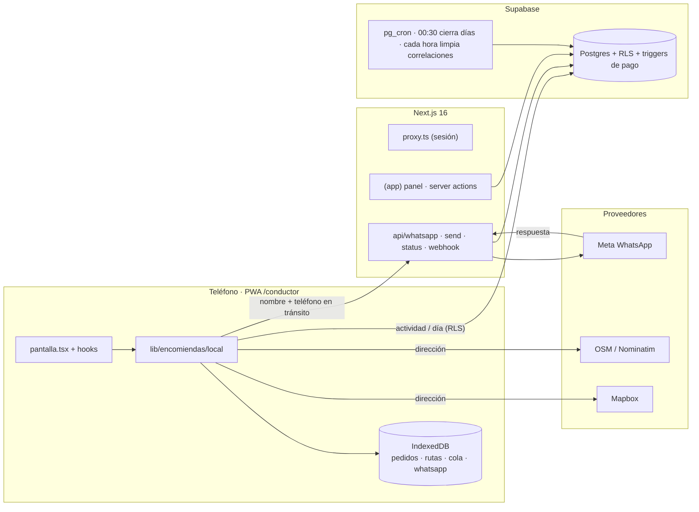
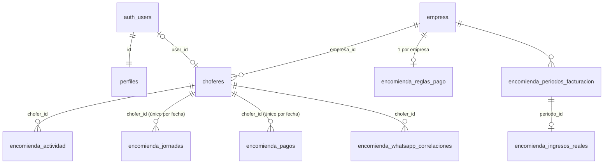
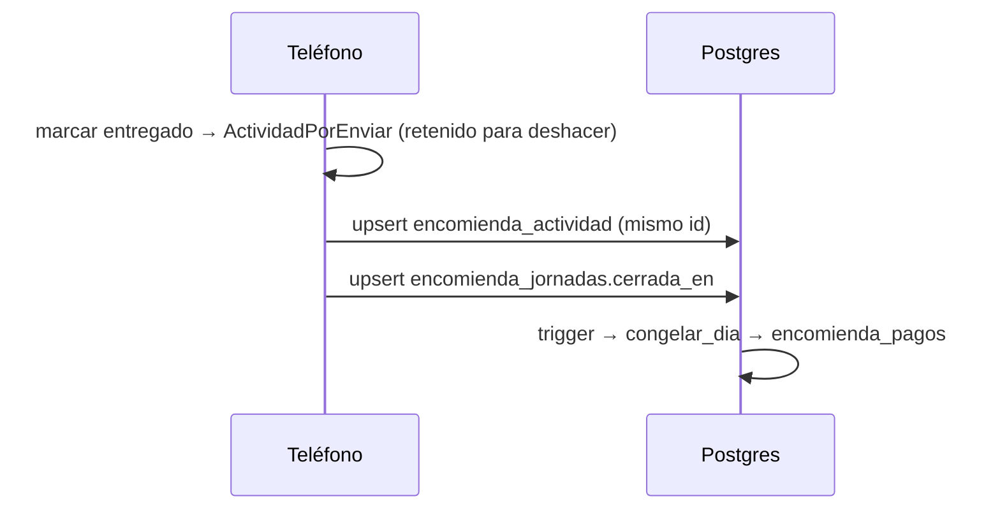
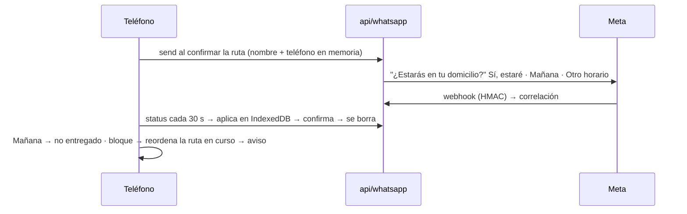

# Arquitectura

Fuente canónica de límites, datos y carpetas (constitución VI). Tipos y módulos en detalle:
`docs/CLASES.md`. Estado: código de `main` al 2026-10-21 (con specs 008 a 010).

## 1. Sistema



Regla: datos de destinatarios solo en el teléfono; al servidor sube el hecho
(`encomienda_actividad`). Ver `docs/PRIVACIDAD.md`.

## 2. Datos

### Servidor (Postgres, `supabase/migrations/0001–0005`, aplicadas el 2026-10-21)



Las tablas conservan sus nombres hasta la spec 002 (US2); en el código ya tienen el del glosario:

| Tabla | Tipo |
|---|---|
| `choferes` · `perfiles` · `empresa` | `Chofer` (→ `Conductor`, spec 002) · `Perfil` · `Empresa` |
| `encomienda_jornadas` | `DiaTrabajo` |
| `encomienda_actividad` | `Actividad` |
| `encomienda_pagos` | `PagoDelDia` (con `TarifaDelDia`) |
| `encomienda_reglas_pago` | `ReglaDePago` |
| `encomienda_whatsapp_correlaciones` | `Aviso` (copia temporal del aviso) |
| `encomienda_periodos_facturacion` · `encomienda_ingresos_reales` | `PeriodoFacturacion` · `IngresoReal` |

Campos completos: `src/types/db.ts` (tipo `Database`, el que usan los clientes de Supabase);
vista esencial: `docs/CLASES.md` §1. Todas llevan `empresa_id` (trigger
`set_empresa_id()`) y RLS.

| Lógica en la base | Qué hace |
|---|---|
| `private.encomienda_congelar_dia()` + triggers en actividad y días | al cerrar el día, calcula el día y lo escribe en `encomienda_pagos` con la tarifa vigente |
| `encomienda_repreciar_dia()` / `encomienda_valorar_dia()` | cambiar la tarifa de un día ya congelado, uno a uno |
| cron 00:30 | cierra días olvidados |
| cron horario + trigger de cierre | borra correlaciones de WhatsApp (cierre, aplicada o 72 h) |

`src/lib/encomiendas/pago.ts` copia la aritmética solo para la vista previa
(`pruebas/base.mjs` verifica que coincidan).

### Teléfono (IndexedDB `pucarani-encomiendas` v3)

| Store | Clave | Contenido | Relación |
|---|---|---|---|
| `pedidos` | `id` | `Pedido`: destinatario, llamada, resultado de la visita y su `aviso` de WhatsApp; `fecha` = su día | `aviso.codigo` ↔ `encomienda_whatsapp_correlaciones` |
| `rutas` | `fecha` | `Ruta`: `orden` de visita + trazado | `orden[]` → pedidos |
| `cola` | `id` | `ActividadPorEnviar` | `id` = `encomienda_actividad.id` (sin duplicados) |

Formas en `local/almacen/tipos.ts`; `idb.ts` (`FilaDe`) tipa cada store y solo `almacen/` lo usa.
v3 (specs 009 y 011) fundió la parada y el aviso en el pedido y renombró los campos al glosario
(`docs/CLASES.md` §0): la migración corre al abrir, en la transacción de versión
(`almacen/migrar.ts`).

El nombre de la base no se cambia (dejaría huérfanos los datos). Un pedido es de un solo día:
lo no entregado se tacha y no pasa al siguiente; si vuelve a salir, se escanea de nuevo (specs 009 y 012). Borrar los días anteriores del
teléfono es la spec 007 (por implementar; hoy quedan guardados pero no se muestran).

## 3. Flujos





## 4. Carpetas (actuales)

```text
src/
├── proxy.ts                      sesión Supabase por request
├── app/(app)/                    panel: encomiendas · choferes · configuracion · @modal
├── app/(conductor)/conductor/    PWA: encomiendas (pantalla, hooks, mapa, formularios)
├── app/api/whatsapp/             send · status · webhook
├── components/                   ui · encomiendas (del conductor) · marco del panel
├── lib/                          auth · supabase · encomiendas · geo · geocoding · rutas · whatsapp · utilidades
│   ├── encomiendas/              catalogos · estados · pago · config · contrato-whatsapp
│   │   └── local/                idb · almacen/ (lecturas, pedidos, ruta, terreno…) · generar-ruta · planificar · replanificar · enviar · whatsapp
│   └── geo/                      coordenada · plus-code · marcar · openrouteservice
└── types/db.ts                   tablas + `Database` para supabase-js (valida pruebas/esquema.mjs)
mcp/ · pruebas/ (487) · supabase/migrations/ (0001–0005) · specs/
```

Estructura objetivo: `specs/002-reestructuracion-codigo/plan.md`. Acceso por rol:
`docs/DOCUMENTO-PRINCIPAL.md` §8.
