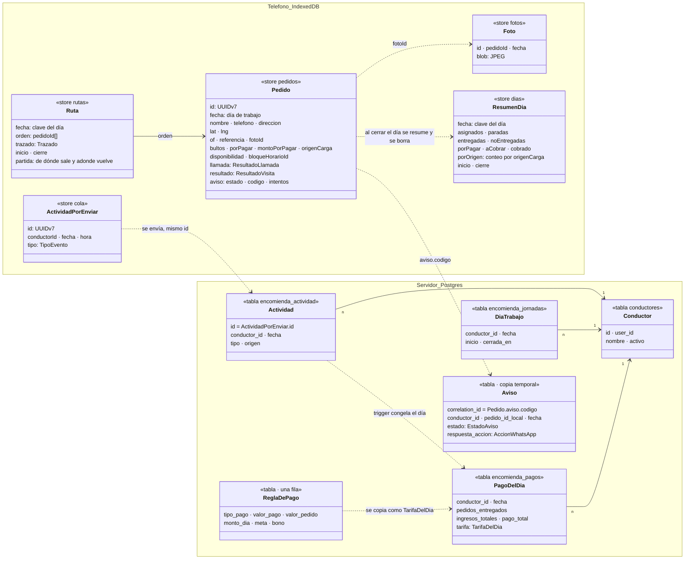
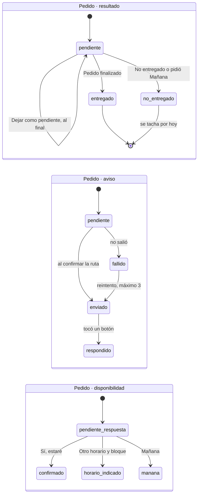
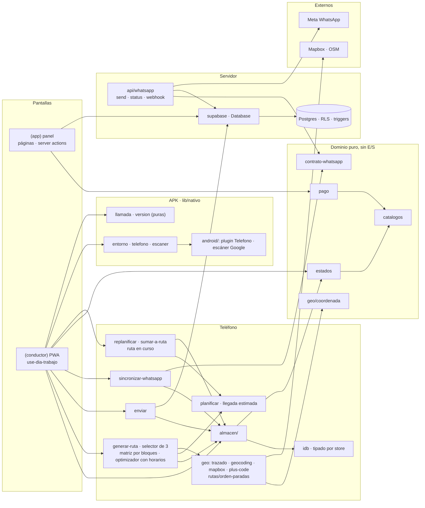

# Clases: modelo esencial

Vista mínima del modelo (2026-10-24: specs 008 a 013 y la APK de la 015): solo las entidades, estados y módulos
que deciden el comportamiento. Campos secundarios, helpers y tipos de UI quedan fuera; el
detalle está en el archivo citado. Fuente canónica junto a `docs/ARQUITECTURA.md`
(constitución VI): cambiar un tipo o módulo de acá actualiza este archivo en el mismo cambio.

Leyenda: `<<store x>>` IndexedDB del teléfono · `<<tabla x>>` Postgres · línea punteada =
flujo o efecto (no es clave foránea) · `·` separa campos de una misma línea.

## 0. Glosario

Un nombre por concepto, el mismo en el diagrama, el código y la pantalla (spec 011). Las tablas
de la base conservan sus nombres viejos hasta la spec 002 (equivalencias en
`docs/ARQUITECTURA.md`).

| Concepto | Nombre |
|---|---|
| Día de trabajo de un conductor | `DiaTrabajo` (en pantalla: "día") · resumen: `ResumenDia` |
| Paquete a entregar ese día | `Pedido` |
| Orden de visita y trazado del día | `Ruta` (`orden`, `trazado`, `inicio`, `cierre`, `partida`) |
| Pedido dentro de la ruta, con su número | `Parada` (solo pantalla) |
| Cómo terminó la visita · la llamada | `Pedido.resultado`: entregado o no entregado · `Pedido.llamada`: `ResultadoLlamada` |
| Lo que dijo el receptor | `Pedido.disponibilidad` |
| Aviso de WhatsApp (uno por pedido, con su estado) | `Pedido.aviso`; en el servidor, copia temporal `Aviso` |
| Hecho que cuenta para el pago | `ActividadPorEnviar` (teléfono) → `Actividad` (servidor) |
| Lo que valió el día · tarifa vigente · tarifa de un día | `PagoDelDia` · `ReglaDePago` · `TarifaDelDia` |
| Avisos en la pantalla del conductor | `Notificacion` |
| Conductor | `Conductor` (tabla `conductores`, rol `conductor`; spec 002, migración 0006) |

## 1. Modelo de datos

Fuera del diagrama: `Perfil` (rol de acceso), `Empresa` (bloques horarios activos) y
facturación (`PeriodoFacturacion`, `IngresoReal`, prioridad baja). Todas
las tablas llevan `empresa_id` y RLS. Tipos de servidor: `src/types/db.ts`; del teléfono:
`src/lib/encomiendas/local/almacen/tipos.ts`.

| Dato | Dónde vive | Tipo |
|---|---|---|
| Destinatario, dirección, llamada, resultado y aviso | Teléfono · `pedidos` (un pedido = un día; se borra al cerrarlo) | `Pedido` |
| Orden de visita y trazado | Teléfono · `rutas` (una fila por día; se borra al cerrarlo) | `Ruta` |
| Cifras de un día ya borrado | Teléfono · `dias` (sobrevive) | `ResumenDia` |
| Foto del paquete | Teléfono · `fotos` (se borra al cerrarse el pedido y con el día) | `Foto` |
| Hecho de entregar u omitir | Teléfono · `cola` → Postgres (mismo id) | `ActividadPorEnviar` → `Actividad` |
| Aviso esperando respuesta | Postgres, máx. 72 h (solo código, estado y respuesta) | `Aviso` |
| Inicio y cierre del día | Postgres | `DiaTrabajo` |
| Pago del día (lo escribe un trigger) | Postgres | `PagoDelDia` + `TarifaDelDia` |
| Regla de pago vigente | Postgres, una fila | `ReglaDePago` |
| Llamadas hechas (número, duración) | Registro de llamadas de Android: la APK lo lee al volver de la llamada y no lo copia | `EntradaRegistro` (en memoria) → `ResultadoLlamada` |

## 2. Estados

Un pedido es de **un solo día** (spec 009). El resultado es **entregado o no entregado**, sin
motivo (spec 012): lo no entregado se tacha por hoy y, si vuelve a salir, se escanea de nuevo.
"Dejar como pendiente" no cierra: manda la parada al final de la ruta. `tipoEventoDe` traduce
el resultado al evento: `entregado` → `entrega`; `no_entregado` → `omision`. Lo guardado
antes (No morador, sin respuesta, rechazo, `omitido`) se lee como `no_entregado` (`alDia`).

El aviso es **uno por pedido** y su estado dice en qué va: pendiente → enviado → respondido, o
fallido con hasta 3 reintentos (spec 011). Vive en el pedido; el servidor guarda una copia
temporal solo mientras espera la respuesta, porque Meta la entrega al servidor.

El aviso sale al confirmar la ruta (spec 010). Reglas de `registrarDisponibilidad`: cada
mensaje se aplica una vez; lo cerrado no se reabre; **Mañana** cierra el pedido como no entregado
con su evento; `HORARIO` sin bloque no cambia nada y dispara la lista de bloques. Mañana o un
bloque reordenan la ruta en curso (`replanificarRuta`): lo cerrado primero, lo sin horario en
su orden, lo con horario donde la llegada estimada cae en su bloque (`planificar.ts`); cada
cambio llega como notificación al conductor.

**Armado de la ruta (spec 017).** La matriz de metros por calle se pide a Mapbox por bloques de
≤ 25 coordenadas (`matrizCalles`): cada par queda en memoria el día entero (no en el teléfono:
son puntos de destinatarios), un pedido más pide solo su fila y su columna, y un contador
mensual en `localStorage` (`ares-matriz-elementos`, tope 90.000 de los 100.000 gratis) corta a
línea recta con aviso. Un par sin camino vale línea recta × 1,3 + 20 km, nunca infinito.
"Respeta horarios" sale del optimizador con horarios (`optimizarConHorarios`: metros + 2000 por
minuto fuera de bloque + 50 por minuto de espera + 5000 por minuto pasadas las 18:00, con el
mismo reloj de `planificar.ts`), que corre por partes para no congelar la pantalla
(`optimizarSinCongelar`). Se sale a las 8:00 como muy temprano. Con la ruta andando,
"Dejar como pendiente" (`dejarParaMasTarde`) y un pedido tardío (`sumarALaRuta`) entran donde
menos alargan (`lugarParaReintentar`, `lugarMasBarato`) sin rehacer la ruta. Deshacer vuelve el
pedido a `pendiente` dentro de la ventana de retención.

Una parada lejos de todas (más de 2 km de la más cercana y más de 4 km de desvío) sale avisada en la
propuesta con lo que suma (`paradasLejanas`, `generar-ruta/lejanas.ts`): en terreno, un punto en la mitad
de una calle de 5 km sumaba 15,8 km a una ruta de 56.

En pasajes y calles residenciales no se da la vuelta (terreno 2026-10-29, `geo/mapbox/vuelta.ts`): la
ruta por calles los pasa de frente y devuelve, por punto, la clase de la calle, su dirección y lo que
costó (`CalleDelPunto`). Con eso `ordenarConSentido` (`generar-ruta/sentido.ts`) vuelve a ordenar "la
más corta" cobrando entrar y salir por el mismo extremo (`Penalizacion` en `orden-paradas/costo.ts`,
simétrica; las jugadas la calculan solo donde cambian vecinos) y se queda con la que mide menos por
calles. En la prueba de 66 paradas (48 en calle estrecha): 42,77 → 42,58 km.

La ruta del día es **cerrada** (terreno 2026-10-28): termina donde empezó, en la central de carga.
El optimizador trata el final como un punto más (`FIN` en `orden-paradas/costo.ts`: 0 en una ruta
abierta, volver a la base en una cerrada), la matriz pide también la vuelta a la partida, el
trazado la dibuja (km y reloj la incluyen) y `Ruta.partida` la guarda para que sumar un pedido
tarde también la cuente (`vueltaEstimada`). Si los dos sentidos miden lo mismo, se arranca por la
parada más cercana.

## 3. Módulos

Reglas de dependencia: el dominio puro no hace E/S; solo `almacen/` toca `idb`; el teléfono
y `/api/whatsapp` comparten `contrato-whatsapp.ts`; toda consulta a Supabase va tipada por
`Database`, sin casts; solo `lib/nativo/` importa `@capacitor/*` y ningún archivo de servidor
lo usa.

## 4. Dónde está cada cosa

| Concepto | Archivo (`src/lib/…` salvo indicación) |
|---|---|
| Listas cerradas: evento, origen, pago, disponibilidad, WhatsApp; `esClave` | `encomiendas/catalogos.ts` |
| Reglas: `tipoEventoDe`, `resultadoCerrado`, `estaConfirmado`, `respuestaDeAccion` | `encomiendas/estados.ts` |
| Botones y payload: orden `CONFIRMAR · MANANA · HORARIO`, `leerAccion` (RECHAZAR legado → MANANA) | `encomiendas/catalogos.ts`, `encomiendas/config.ts` |
| Llegada estimada y lugar de un pedido con horario; dónde menos alarga uno nuevo o uno que se reintenta (`lugarMasBarato`, `lugarParaReintentar`) | `encomiendas/local/planificar.ts` |
| "Dejar como pendiente" y pedidos tardíos sin rehacer la ruta (`dejarParaMasTarde`, `sumarALaRuta`) | `encomiendas/local/sumar-a-ruta.ts` |
| Modo prueba: nada a la base ni por WhatsApp; al salir se borra lo de la prueba (`enModoPrueba`, `entrarAlModoPrueba`, `salirDelModoPrueba`, `useModoPrueba`; `localStorage` `ares-modo-prueba`) | `encomiendas/local/modo-prueba.ts` |
| GPS simulado del modo prueba: parte en la central y avanza solo por la línea de navegación hasta la parada activa, a ×1, ×5, ×10 o ×20 —sobre ×5 lee cuatro veces por segundo y no pasa por el filtro de velocidad imposible— (`fuenteUbicacion`, `useSimularRecorrido`, `puntoEnCamino`; `localStorage` `ares-gps-simulado`) | `encomiendas/local/gps-simulado.ts` |
| La ruta en curso se reordena con las respuestas | `encomiendas/local/replanificar.ts` |
| `Coordenada`, `PuntoLngLat`, `Trazado`, `distanciaMetros`, `CENTRO_ARICA`, `RECUADRO_ARICA` | `geo/coordenada.ts` |
| Contrato teléfono ↔ `/api/whatsapp/*` | `encomiendas/contrato-whatsapp.ts` |
| Stores y su forma (`FilaDe`) | `encomiendas/local/idb.ts` |
| Operaciones del teléfono: lecturas, pedidos, ruta, terreno, aviso y disponibilidad, cola; migración v2 → v3 | `encomiendas/local/almacen/` (barril `index.ts`) |
| Esquema Postgres para supabase-js | `src/types/db.ts` (`Database`) |
| Cifras del panel a partir de pagos congelados | `encomiendas/pago.ts` |
| Indicadores del período y comparación con el anterior: `calcularIndicadores`, `periodoAnterior` (spec 006) | `encomiendas/indicadores.ts`, `(app)/encomiendas/_componentes/indicadores.tsx` |
| APK con respaldo web: `esApp`, `alBotonAtras`, `llamar`, `llamadasDesde`, `pantallaEncendida`, `escanearCodigo` | `nativo/entorno.ts`, `nativo/telefono.ts`, `nativo/escaner.ts` |
| Contestó o no según el registro (≥ 5 s); aviso de APK vieja | `nativo/llamada.ts`, `nativo/version.ts` |
| OF y referencia del paquete: `formatoOf`, `ofValida` (solo dígitos, sin regla de largo ni ceros a la izquierda), `ofDistinta` (la que no tiene 9: va con ⚠), `textoReferencia`, `buscarPorOf` · listas `TIPOS_PAQUETE`, `TAMANOS_PAQUETE`, `COLORES_PAQUETE` | `encomiendas/paquete.ts`, `encomiendas/catalogos.ts` |
| Paquete y foto en el teléfono: `guardarPaquete`, `ofRepetida`, `guardarFoto`, `purgarFotosCerradas` | `encomiendas/local/almacen/paquete.ts` |
| Carga del día (spec 005): leer la guía, la etiqueta y su código de barras (puros) | `encomiendas/lectura/{guia,etiqueta,codigo-barras}.ts` |
| Pedidos desde la guía y escaneo → "PARADA n de N": `crearDesdeGuia`, `aplicarLecturaEtiqueta`, `sinEtiquetaEscaneada`; dirección de la etiqueta: `cambiarDireccion` (`pedidos.ts`) | `encomiendas/local/almacen/carga.ts` |
| Lectura de una foto: primero el texto en el teléfono (`leerImagen`, `textoDeFoto` con ML Kit, `etiquetaCompleta`) y, si no alcanza, la IA: esquemas, contrato, llamada a Claude (`server-only`) | `encomiendas/lectura/{esquemas,contrato,servidor}.ts`, `encomiendas/local/lectura-cliente.ts`, `src/app/api/lectura/route.ts` |
| Cierre del día: no entregados, resumen y borrado; cierre de sesión | `encomiendas/local/almacen/borrado.ts` (`STORES_DEL_DIA` en `idb.ts`) |
| Plugin nativo `Telefono` (Java) | `android/app/src/main/java/cl/pucarani/ares/TelefonoPlugin.java` |
| Sesión y puertas (`exigirPanel`, `exigirConductor`); rol y destino por rol (`leerRol`, `inicioSegunRol`); ficha por usuario | `auth/sesion.ts`, `auth/roles.ts`, `auth/conductor-de-usuario.ts` |
| Días "YYYY-MM-DD" en hora de Chile (`hoyChile`, `sumarDias`, `esFecha`), `MESES`; periodo del panel y su cookie | `comun/fechas.ts`, `comun/periodo.ts` (+ `periodo-servidor.ts`) |
| Orden de paradas (exacto hasta 14 puntos; si no, construcción + mejora + sacudidas; la propuesta busca a fondo —hasta 300 sacudidas seguidas sin mejora— con la pantalla `BuscandoRuta` encima, y reusa el orden de un grupo repetido entre estrategias) · con horarios (`optimizarConHorarios`, por partes en `optimizarSinCongelar`) | `rutas/orden-paradas/` (`con-horarios.ts`, `sin-congelar.ts`) |
| Matriz de calles por bloques, en memoria y con tope mensual (`matrizCalles`, `planificarConsultas`) | `geo/mapbox/matriz.ts` |
| Corregir con IA una dirección sin ubicar (spec 018): conversación y validación (`conversacionValida`), una ida con Claude (`pasoDireccionIA`, `server-only`), el bucle en el teléfono (`corregirConIA`, `interpretar`); los del día, a confirmar por el conductor (`corregirSinUbicar`, `esSegura` —la calle entera, sin el número, nunca es segura—, `aplicarCorreccion`) | `geo/direccion-ia/{contrato,servidor,cliente}.ts`, `src/app/api/direccion-ia/route.ts`, `encomiendas/local/corregir-direcciones.ts` |
| Trazado en el teléfono: pegar al camino, rumbo, metros restantes · Mapbox: token, direcciones, navegación (`PasoNavegacion` con `duracionS` y `salida` de rotonda; al salir hacia una parada pide también la ruta sin rumbo; `elegirSalida` la usa si ahorra 200 m desde el mismo punto (casa atrás o parada en esquina) y marca "Da la vuelta" solo si arranca hacia atrás; dar la vuelta solo en calles anchas (`vuelta.ts`: clase de Mapbox trunk/primary/secondary/tertiary), y la ruta del día se vuelve a pedir con el rumbo fijo donde se devolvía en un pasaje o residencial) · recorrido del tramo: `pasoEnCurso` (el cartel cambia al doblar la esquina, o al aparecer sobre un paso posterior) y `restanteDelTramo` (metros a la maniobra, metros y segundos a la parada) | `geo/trazado.ts` · `geo/mapbox/` (`recorrido.ts`) |
| Ubicar una dirección (`ubicarDireccion`): limpiar la consulta, `coincidenciaCalle` (tipeo acotado), catálogo de calles de Arica (`callesParecidas`, `largoDeCalle`) | `geo/geocoding/`: `ubicar.ts`, `consulta.ts`, `calles.ts` + `calles-arica.ts` (generado), `completar-numero.ts`, `mapbox.ts`, `nominatim.ts`, `codigo.ts`; `index.ts` es el barril |

## 5. Pendiente

- `valor_pago` es `numeric`: PostgREST lo entrega como texto y `pago.ts` lo convierte.
- Guía y etiqueta escaneadas, posición en la ruta: spec 005.
