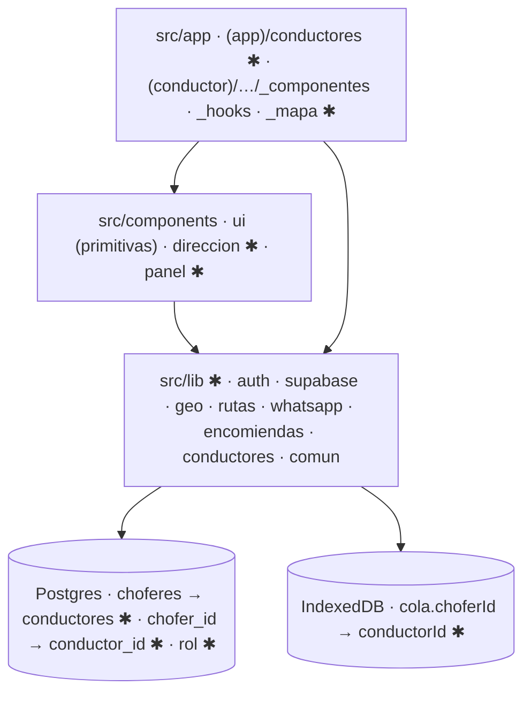

# Implementation Plan: Reestructuración del código y "conductor"

**Branch**: `002-reestructuracion-codigo` · **Spec**: [spec.md](spec.md)

## Summary

`src/lib` por dominio, componentes junto a quien los usa, prueba de arquitectura, 14
archivos > 400 líneas divididos, y `chofer` → `conductor` en todo (base incluida, migración
idempotente en ventana nocturna). Sin cambios de comportamiento.

## Technical Context

- **Stack**: TypeScript 5, React 19.2, Next.js 16.4.2 (Turbopack, `proxy.ts`), Supabase.
  Sin dependencias nuevas.
- **Storage**: Postgres (9 tablas, RLS, triggers de pago, `pg_cron`) · IndexedDB (4 stores).
- **Testing**: `node:test` (490), `test:base`/`test:esquema` (requieren credenciales), build.
- **Constraints**: sin cambios de comportamiento salvo `/choferes`; cero eventos perdidos;
  cada fase cierra en verde.
- **Scope**: ~75 archivos en `src/`; ~20 rutas de `lib/` importadas por `pruebas/` y `mcp/`.

## Constitution Check

I–IV PASS (sin cambios de pantalla ni de reglas; la cola protege las entregas) · V PASS (no
cambia qué datos salen) · VI PASS (diagrama y snapshot abajo; `docs/` en US4).

## Límites afectados



## Datos

| Dónde | Objeto | Cambio |
|---|---|---|
| Postgres | `choferes` | → `conductores` (+ índices, triggers, policies) |
| Postgres | `chofer_id` en actividad, días, pagos, correlaciones | → `conductor_id` |
| Postgres | enum `rol_usuario` `chofer` | → `conductor` |
| Postgres | 10 funciones + 2 RPC | recreadas (research R5) |
| IndexedDB | `cola.choferId` | → `conductorId` (lectura tolerante) |
| Storage | `fotos/choferes/` | se conserva; nuevas en `conductores/` |

Detalle y orden de la migración: [data-model.md](data-model.md).

## Estructura objetivo

```text
src/
├── app/
│   ├── (app)/conductores/ (← choferes) · _componentes/vencimiento-badge.tsx
│   ├── (app)/encomiendas/ · _datos.ts · _resumen.ts · _tarifa.ts · _componentes/ · actions/ · dia/_componentes/dia-nav.tsx
│   └── (conductor)/conductor/encomiendas/ · pantalla.tsx (composición) · _componentes/ · _hooks/ · _mapa/
├── components/ · ui/ · direccion/ (direccion-input, mapa-punto) · panel/ (app-shell, page-header, periodo-selector, notificaciones)
└── lib/
    ├── auth/ sesion [server-only] · roles · acciones ("use server") · api-conductor [server-only] · conductor-de-usuario
    ├── supabase/ server · client · admin · sesion-proxy (← middleware)
    ├── geo/ coordenada · distancia · trazado · plus-code · marcar · openrouteservice · geocoding/ · mapbox/ (token, direcciones, navegacion, mapa-estatico)
    ├── rutas/ orden-paradas/
    ├── whatsapp/ meta [server-only] · telefono · correlacion
    ├── encomiendas/ config · pago · periodos · local/ (idb, enviar, sincronizar-whatsapp, resumen-dia, almacen/, generar-ruta/)
    ├── conductores/ vencimientos
    └── comun/ fechas · format · forms · utils · uuid · deslizar · periodo · periodo-servidor [server-only]
```

**Una sola definición (FR-004)**: meses y meses cortos (4 + 2 copias) · cookie de período
(2) · token de Mapbox (5 lecturas) · centro y recuadro de Arica (2) · distancia (2) · lectura
del rol (5) · ficha del conductor por usuario (3) · `FormState` (3) · destino por rol
(`set-password` no usa `inicioSegunRol`) · `telHref` duplica `telefono.ts`.

**Excepciones de tamaño (FR-013)**: ninguna prevista; si aparece, se lista aquí y en la
prueba de arquitectura.

## Complexity Tracking

No aplica.
