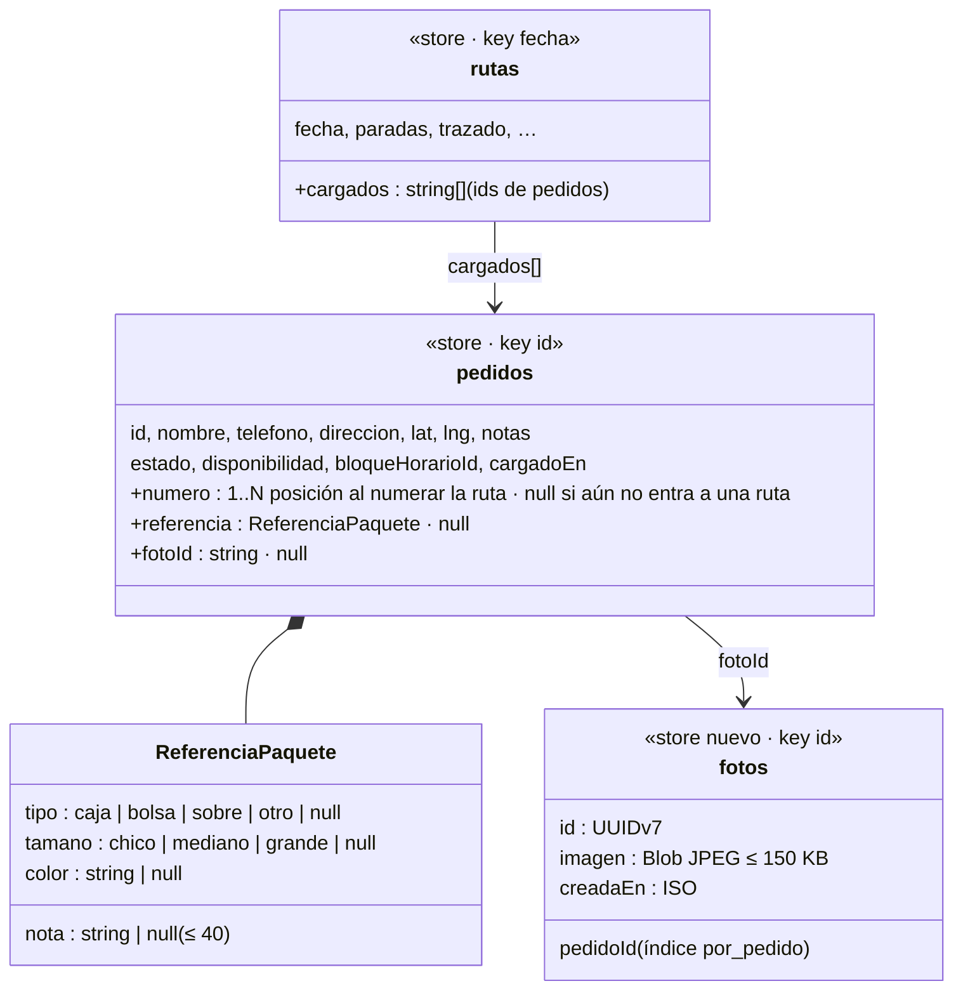

# Data Model: Número y referencia de cada paquete

Todo lo de esta feature vive en el IndexedDB del teléfono y **se borra al cerrar el día**
(spec 007). **El servidor no cambia.**



## 1. Campos nuevos en `pedidos`

| Campo | Tipo | Regla |
|---|---|---|
| `numero` | entero ≥ 1 \| null | Se asigna en `guardarRuta()`: en la primera confirmación del día, la posición en la ruta; después, mayor + 1 para los que no tienen. **No cambia durante el día.** Único entre los pedidos del día |
| `referencia` | `ReferenciaPaquete \| null` | Opcional. Cada parte puede faltar. `nota` recortada a 40 caracteres |
| `fotoId` | string \| null | Id en el store `fotos`. Se conserva al editar el pedido si el formulario no lo cambia |

`alDia()` completa `numero: null`, `referencia: null` y `fotoId: null` cuando faltan.

`guardarPedido()` rearma el pedido desde el formulario y conserva a mano `estado`,
`disponibilidad`, `bloqueHorarioId` y `cargadoEn`; suma `numero` (siempre del anterior) y
`fotoId` (del formulario si viene, si no del anterior). **No asigna números.**

## 2. Campo nuevo en `rutas`

| Campo | Tipo | Regla |
|---|---|---|
| `cargados` | `string[]` | Ids de pedidos marcados como cargados ese día. `guardarRuta()` lo conserva al rehacer la ruta, filtrando ids que ya no están en ella. `rutaAlDia()` completa `[]` |

## 3. Store nuevo `fotos`

| Campo | Tipo | Regla |
|---|---|---|
| `id` | UUIDv7 | Clave |
| `pedidoId` | string | Índice `por_pedido` |
| `imagen` | Blob (JPEG) | ≤ 800 px de lado mayor, calidad 0,6 |
| `creadaEn` | ISO | Referencia para auditoría del borrado |

Borrado (FR-011, research R5): al dejar de estar activo su pedido, las huérfanas al abrir la
app, y todas al cerrar el día (spec 007).

## 4. Lo que NO cambia

- `cola`: los eventos siguen siendo `{id, choferId, fecha, tipo, hora}`; número,
  referencia y foto **no** viajan (prueba en T010).
- `whatsapp`: sin cambios.
- Postgres: sin cambios.

## 5. Transiciones del número

```text
alta del pedido              ──► numero = null
primera confirmación de ruta ──► numero = posición en la ruta (1…N)        (dentro de enFila)
reoptimizar / rehacer ruta   ──► con número: se conserva · sin número: mayor + 1
editar el pedido             ──► se conserva
eliminado y restaurado       ──► se conserva (mismo día)
cierre del día               ──► se borra con el pedido (spec 007)
```
