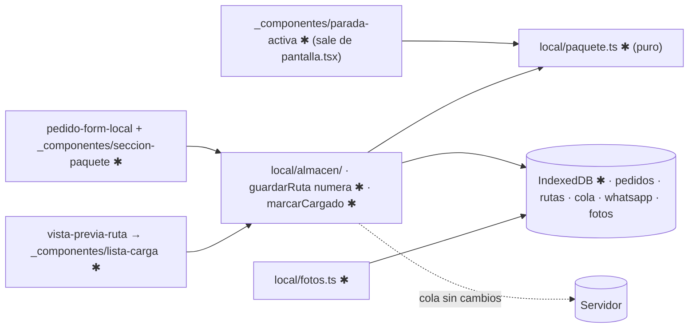

# Implementation Plan: Número y referencia de cada paquete

**Branch**: `003-referencia-paquete` · **Spec**: [spec.md](spec.md)

## Summary

`guardarRuta()` numera los pedidos con su posición en la primera confirmación del día y los
deja fijos (tardíos: mayor + 1). Referencia por toques y foto opcional. Tarjeta de parada con
"#12 · Bolsa gris grande"; lista de carga inversa con marcas; búsqueda por número. Todo en
IndexedDB (store `fotos`, siguiente versión libre), borrado al cerrar el día (007). Servidor sin cambios.

## Technical Context

- **Stack**: TypeScript 5, React 19.2, Next.js 16.4. Sin dependencias nuevas (foto con
  `<input capture>` + `<canvas>`).
- **Storage**: IndexedDB: store `fotos` en la siguiente versión libre de `idb.ts` (v4: la v3 la tomó la
  spec 009), registrado en `STORES_DEL_DIA` (spec 007). Postgres sin cambios.
- **Testing**: `node:test` + `fake-indexeddb`.
- **Performance**: guardar < 100 ms; foto ≤ 150 KB; ≤ 60 fotos vivas.
- **Constraints**: offline; números únicos y fijos aun con doble toque; compatible con v2.
- **Prerrequisito**: spec 002 Fase 1–2 + US1.

## Constitution Check

I PASS (3 toques, número grande) · II PASS (no toca estados) · III PASS (pruebas de unicidad,
fijeza, migración de versión, cola sin campos nuevos) · IV PASS (sin proveedores) · V PASS (solo
teléfono, borrado diario) · VI PASS (diagrama y datos abajo).

## Límites afectados



## Datos

| Dónde | Objeto | Cambio |
|---|---|---|
| IndexedDB | base | siguiente versión libre |
| IndexedDB | `pedidos` | + `numero`, `referencia`, `fotoId` (lectura tolerante) |
| IndexedDB | `rutas` | + `cargados: string[]` |
| IndexedDB | `fotos` (nuevo) | `{id, pedidoId, imagen: Blob, creadaEn}`, índice `por_pedido` |

Detalle: [data-model.md](data-model.md) · funciones: [contracts/almacen-paquete.md](contracts/almacen-paquete.md).

## Project Structure

```text
src/lib/encomiendas/
├── config.ts                 ✱ TIPOS_PAQUETE, TAMANOS_PAQUETE, COLORES_PAQUETE, ReferenciaPaquete
└── local/
    ├── idb.ts                ✱ siguiente VERSION, store fotos en STORES_DEL_DIA
    ├── almacen.ts            ✱ tipos, alDia, guardarRuta (numera, conserva cargados), marcarCargado
    ├── paquete.ts            ✱ NUEVO puro: asignarNumeros, describirPaquete, buscarPorNumero, ordenDeCarga
    └── fotos.ts              ✱ NUEVO: comprimir, guardar, leer, borrar, purgar
src/app/(conductor)/conductor/encomiendas/
├── pedido-form-local.tsx     ✱ monta seccion-paquete
├── pantalla.tsx              ✱ usa parada-activa, lista de carga, búsqueda
└── _componentes/             ✱ parada-activa, seccion-paquete, paquete-chips, foto-paquete, lista-carga, buscar-numero
pruebas/                      ✱ paquete.test.mjs, fotos.test.mjs, idb-version.test.mjs, 3-almacen (ampliado), 4-envio (cola)
```

La numeración vive en `guardarRuta()` (ya corre en `enFila()`): el número es la posición de
la ruta confirmada. La tarjeta de parada sale de `pantalla.tsx` (adelanta 002-T037).

## Complexity Tracking

No aplica.
