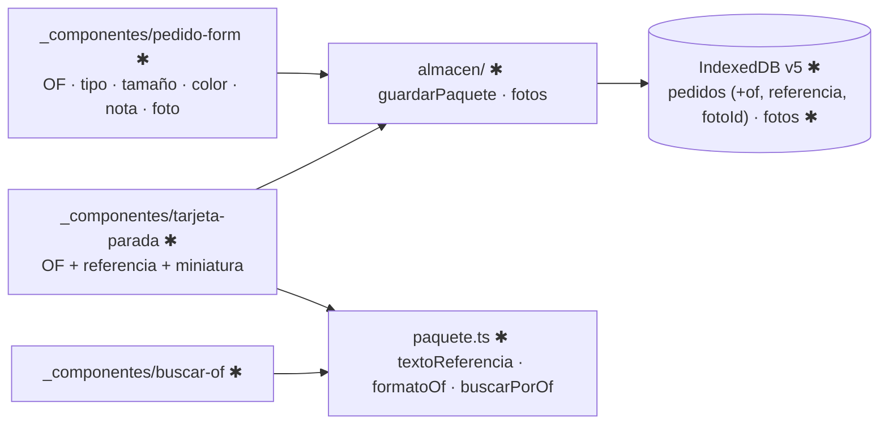

# Implementation Plan: OF y referencia del paquete (003)

**Branch**: `003-referencia-paquete` | **Date**: 2026-10-24 | **Spec**: [spec.md](spec.md)

## Summary

El pedido suma la OF (opcional a mano), una referencia de cómo es el paquete y una foto. La
tarjeta de la parada activa muestra OF y referencia en lo más grande y la OF sigue a la vista al
marcar la entrega. Búsqueda de la parada por los últimos dígitos de la OF. Nada se escribe en el
paquete. Decisiones en [research.md](research.md).

**Prerrequisito**: spec 002 Fase 1–2 + US1 (carpetas `_componentes/` y `_hooks/` del conductor).

## Technical Context

- **Stack**: TypeScript 5, Next.js 16.4, IndexedDB; sin dependencias nuevas. Android (APK de la
  015) o navegador.
- **Storage**: `Pedido` + `of`, `referencia`, `fotoId`; store nuevo `fotos` (IndexedDB v5; la v4 la tomó la 007).
- **Testing**: `node:test` + `fake-indexeddb` (almacén, migración v5, referencia, búsqueda).
- **Constraints**: sin conexión; fotos ≤ ~150 KB; todo se borra con el día (007).

## Constitution Check

| Principio | Estado | Evidencia |
|---|---|---|
| I. Conductor | PASS | Referencia en 3 toques; OF y referencia lo primero de la parada |
| II. Verdad de la entrega | PASS | No toca resultados ni disponibilidad |
| III. Pruebas | PASS | `pruebas/paquete.test.mjs`, migración v5 |
| IV. Servicios externos | PASS | Sin proveedores |
| V. Datos y cumplimiento | PASS | OF, referencia y foto solo en el teléfono; fotos se borran al cerrar el pedido y el día |
| VI. Arquitectura verificable | PASS | Diagrama y tabla abajo; `docs/CLASES.md` y `docs/ARQUITECTURA.md` en T013 |

## Diagrama (✱ = nuevo o cambia)



## Snapshot de datos

| Dónde | Objeto | Cambio |
|---|---|---|
| IndexedDB | `pedidos` | + `of`, `referencia`, `fotoId` (completados por `alDia`) |
| IndexedDB | `fotos` | nuevo (v5): `{ id, pedidoId, fecha, blob }` |
| `catalogos.ts` | `TIPOS_PAQUETE`, `TAMANOS_PAQUETE`, `COLORES_PAQUETE` | nuevos |
| Postgres | — | sin cambios |

Detalle en [data-model.md](data-model.md); API del almacén en
[contracts/almacen-paquete.md](contracts/almacen-paquete.md).

## Project Structure

```text
src/lib/encomiendas/
├── catalogos.ts                         ✱ listas del paquete
├── paquete.ts                           ✱ textoReferencia · formatoOf · ofValida · buscarPorOf (puras)
└── local/
    ├── idb.ts                           ✱ v5: store fotos
    ├── foto.ts                          ✱ comprimirFoto (canvas)
    └── almacen/
        ├── tipos.ts · migrar.ts         ✱ campos nuevos y alDia
        ├── pedidos.ts                   ✱ guardarPedido conserva of y referencia
        └── paquete.ts                   ✱ guardarPaquete · ofRepetida · guardarFoto · leerFoto · borrarFoto · purgarFotosCerradas
src/app/(conductor)/conductor/encomiendas/
├── _componentes/pedido-form-local.tsx   ✱ OF arriba de todo
├── _componentes/campos-paquete.tsx      ✱ tipo · tamaño · color · nota · foto
├── _componentes/tarjeta-parada.tsx      ✱ (sale de pantalla.tsx)
├── _componentes/buscar-of.tsx           ✱ (desde el menú lateral)
└── _hooks/use-foto-paquete.ts           ✱ URL de la foto guardada o recién tomada
pruebas/paquete.test.mjs · pruebas/idb-version.test.mjs (v3 → v5)   ✱
```

**Structure Decision**: dominio puro en `paquete.ts`; IndexedDB solo en `almacen/`; UI en
`_componentes/` (estructura de la 002).
