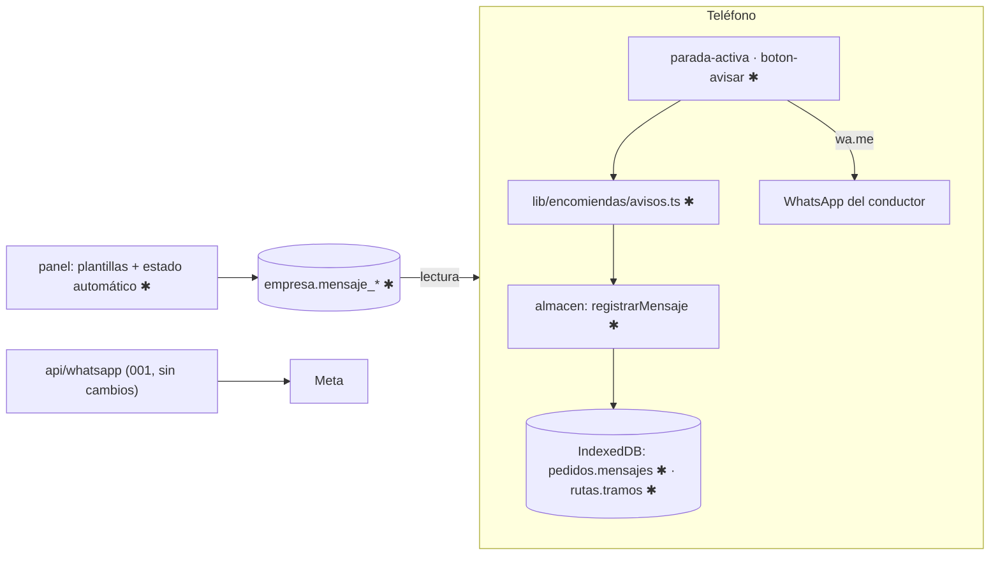

# Implementation Plan: Menos visitas fallidas

**Branch**: `004-menos-visitas-fallidas` | **Date**: 2026-10-20 | **Spec**: [spec.md](spec.md)

## Summary

Botón "Avisar" que abre el WhatsApp del conductor con mensaje prellenado (y "avisar a todos"), botón "voy llegando" a ≤10 min estimados, lista "No entregados" y estado del aviso automático en el panel. Todo local salvo dos textos de plantilla en `empresa`.

## Technical Context

- **Stack**: TypeScript 5, React 19.2, Next.js 16.4 (sin dependencias nuevas).
- **Storage**: IndexedDB (campos nuevos en `pedidos` y `rutas`); Postgres: 2 columnas en `empresa`.
- **Testing**: `node:test` + `fake-indexeddb`.
- **Constraints**: offline salvo plantillas; ningún dato de receptor al servidor; borrado diario (007).
- **Prerrequisitos**: spec 002 Fase 1–2 + US1; spec 003 (tarjeta `parada-activa.tsx`); spec 005 aporta teléfono y OF (sin 005, se cargan a mano).

## Constitution Check

| Principio | Estado | Evidencia |
|---|---|---|
| I Conductor | PASS | un toque por aviso; "llegando" solo cuando sirve |
| II Verdad | PASS | avisos y disponibilidad separados del resultado de entrega |
| III Pruebas | PASS | mensaje, enlace, ETA, no doble aviso, devoluciones |
| IV Externos | PASS | WhatsApp propio sin API; automático con respaldo manual |
| V Datos | PASS | nada sale del teléfono por el servidor; Meta registrado en `docs/PRIVACIDAD.md` |
| VI Arquitectura | PASS | diagrama y snapshot abajo |

## Diagrama (límites afectados)



## Data snapshot

| Dónde | Objeto | Cambio |
|---|---|---|
| IndexedDB | `pedidos` | `mensajes[]` |
| IndexedDB | `rutas` | `tramos[]` (duración por parada) |
| Postgres | `empresa` | `mensaje_aviso`, `mensaje_llegando` |
| Postgres | resto | sin cambios |

Detalle: [data-model.md](data-model.md). Decisiones: [research.md](research.md).

## Project Structure

```text
src/lib/encomiendas/avisos.ts              ✱ puro: construirMensaje, enlaceWhatsapp, franjaEstimada,
                                             minutosHastaParada, ofrecerLlegando, yaAvisado
src/lib/encomiendas/config.ts              ✱ textos por defecto y marcadores
src/lib/encomiendas/local/almacen/       ✱ MensajeEnviado, mensajes[], registrarMensaje, tramos
src/lib/geo/mapbox/direcciones.ts          ✱ devolver legs (distancia, duración) por tramo
src/lib/encomiendas/local/generar-ruta/    ✱ guardar tramos en la ruta
src/app/(conductor)/conductor/encomiendas/_componentes/
  boton-avisar.tsx · avisar-todos.tsx · registrar-respuesta.tsx   ✱
  lista-no-entregados.tsx                   (de la spec 007; aquí solo se abre desde la hoja)
  parada-activa.tsx                         ✱ botón "voy llegando"
src/app/(app)/configuracion/
  plantillas-form.tsx · estado-whatsapp.tsx ✱  actions.ts ✱ guardarPlantillas
supabase/migrations/000N_avisos.sql         ✱ próxima migración libre
src/types/db.ts                             ✱ Empresa.mensaje_*
pruebas/avisos.test.mjs                     ✱ · pruebas/3-almacen.test.mjs ✱
```

**Structure Decision**: lógica pura en `lib/encomiendas/avisos.ts`; UI junto a la app del conductor; panel en `configuracion/` siguiendo `bloques-horarios-form.tsx`.

## Complexity Tracking

No aplica.
