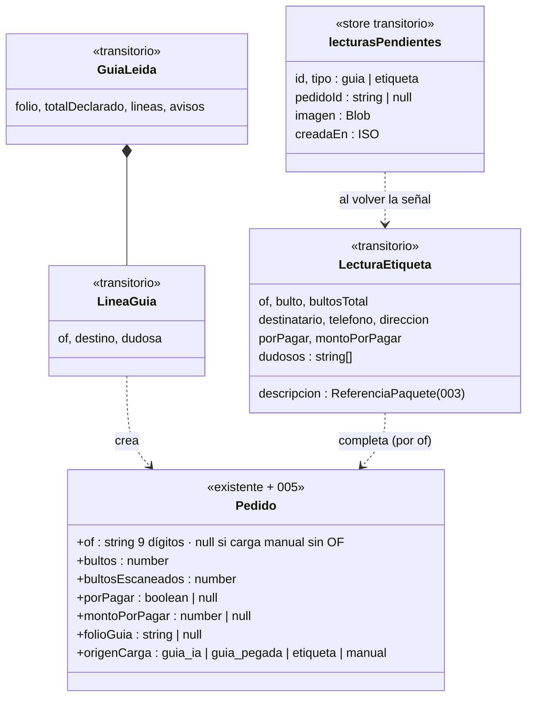

# Data Model: carga desde guía y escaneo de etiquetas

Todo en el teléfono, borrado al cerrar el día (spec 007). Servidor sin cambios.

## Reglas

| Campo | Regla |
|---|---|
| `of` | Clave del día. Único entre pedidos activos. Solo del código de barras o impreso confirmado (FR-007, FR-008) |
| `bultos` / `bultosEscaneados` | De `Bulto N° 00x/00y`; parada completa cuando son iguales |
| `porPagar` | `true` solo si dice POR PAGAR; `CONTADO`/`CTA CTE` → `false`; ilegible → `null` ("por revisar") |
| `montoPorPagar` | De "Total Monto O.F."; nunca se supone 0 (FR-015) |
| `telefono` | Normalizado +569 con `lib/whatsapp/telefono.ts` |
| `descripcion` | Llena `referencia` de spec 003 |
| `origenCarga` | Sale al resumen del día como conteo (007) |
| `lecturasPendientes` | Se borra al leer con éxito o al cerrar el día; nunca sale del teléfono salvo hacia `/api/lectura` |

## Lo que no cambia

- Ruta y su algoritmo (`generar-ruta.ts`).
- `cola`: eventos sin datos de destinatarios.
- Postgres.
