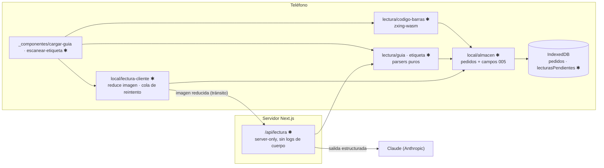

# Implementation Plan: Carga del día desde la guía y escaneo de etiquetas

**Branch**: `005-carga-rapida-pedidos` | **Date**: 2026-10-20 | **Spec**: [spec.md](spec.md)

## Summary

- Guía (foto o texto pegado) → parser + IA opcional → `LineaGuia[]` → pedidos → ruta existente.
- Etiqueta: código de barras en el teléfono (OF + bulto) → parada; foto → IA → destinatario, teléfono, por pagar, descripción.
- IA vía `POST /api/lectura` (Claude, salida estructurada); sin IA, parsers por palabras clave.
- Todo local y borrado al cerrar el día (spec 007). Decisiones técnicas: `research.md`.

## Technical Context

- **Stack**: TypeScript 5, React 19.2, Next.js 16.4.2. Nuevas dependencias: `zxing-wasm` (código de barras), `@anthropic-ai/sdk` (servidor).
- **Storage**: IndexedDB: campos nuevos en `pedidos`; store transitorio `lecturasPendientes`. Postgres sin cambios.
- **Testing**: `node:test`; fixtures anonimizados en `pruebas/fixtures/lectura/`; prueba manual con ≥ 50 etiquetas (SC-003).
- **Platform**: PWA en iPhone (Safari); endpoint Node en el servidor Next.js.
- **Performance**: código de barras ≤ 1 s sin red; lectura IA ≤ 3 s con señal.
- **Constraints**: OF solo del código (o impreso confirmado); sin fotos ni cuerpos en servidor/logs; offline-first.
- **Scale**: ≤ 60 etiquetas + 1–3 fotos de guía por día.

## Constitution Check

| Principio | Estado | Evidencia |
|---|---|---|
| I. Conductor | PASS | Escaneo de un toque; parada en grande; revisión solo de dudosos |
| II. Verdad de la entrega | PASS | No toca estados de entrega; monto nunca supuesto |
| III. Pruebas | PASS | Parsers puros con fixtures; contrato del endpoint; prueba de enlace SC-003 |
| IV. Servicios externos | PASS | Sin IA o sin red el flujo sigue (código de barras + texto pegado) |
| V. Datos y cumplimiento | PASS | Solo campos necesarios; nada guardado en servidor; Anthropic registrado en `docs/PRIVACIDAD.md` §3; autorización al lanzamiento (007) |
| VI. Arquitectura verificable | PASS | Diagrama y snapshot abajo; actualizar `docs/ARQUITECTURA.md` y `docs/CLASES.md` |

**Prerrequisitos**: spec 002 Fase 1–2 + US1; spec 003 (referencia y numeración); spec 007 US1 (borrado diario).

## Diagrama (límites afectados)



## Snapshot de datos

| Dónde | Objeto | Cambio |
|---|---|---|
| IndexedDB | `pedidos` | + `of`, `bultos`, `bultosEscaneados`, `porPagar`, `montoPorPagar`, `folioGuia`, `origenCarga` |
| IndexedDB | `lecturasPendientes` (nuevo, transitorio) | foto + tipo hasta leerse; se borra al leer o al cerrar el día |
| IndexedDB | resumen del día (007) | + conteo por `origenCarga` |
| Servidor | — | nada persistido; endpoint en tránsito |
| Proveedor | Anthropic | imagen + respuesta; ver `docs/PRIVACIDAD.md` §3 |

Detalle: [data-model.md](data-model.md). Contrato: [contracts/lectura.md](contracts/lectura.md).

## Project Structure

```text
src/
├── lib/encomiendas/
│   ├── lectura/
│   │   ├── codigo-barras.ts      puro: 26 dígitos → {of, bulto, agencia}
│   │   ├── guia.ts               puro: texto → LineaGuia[] + avisos
│   │   ├── etiqueta.ts           puro: texto → campos de etiqueta
│   │   ├── esquemas.ts           JSON schema de guía y etiqueta (contrato)
│   │   └── servidor.ts           [server-only] llamada a Claude
│   └── local/
│       ├── almacen.ts            campos 005, crearDesdeGuia, aplicarLecturaEtiqueta
│       └── lectura-cliente.ts    reducir imagen, POST /api/lectura, reintentos
├── app/api/lectura/route.ts      POST, conductor autenticado
└── app/(conductor)/conductor/encomiendas/
    ├── _componentes/cargar-guia.tsx · revisar-guia.tsx · escanear-etiqueta.tsx · resultado-escaneo.tsx
    └── _hooks/use-escaner.ts     cámara + zxing-wasm

pruebas/
├── lectura-codigo-barras.test.mjs · lectura-guia.test.mjs · lectura-etiqueta.test.mjs
├── lectura-endpoint.test.mjs     contrato, sin logs, validación
└── fixtures/lectura/             textos y respuestas anonimizados
```

**Structure Decision**: parsers en `lib/encomiendas/lectura/` (puros, compartidos por teléfono y servidor); llamada a Claude aislada en `servidor.ts` con `server-only` (agregar a la regla A5 de `pruebas/arquitectura.test.mjs`). UI junto a la app del conductor.

## Complexity Tracking

| Violation | Why Needed | Simpler Alternative Rejected Because |
|---|---|---|
| No aplica | — | — |
