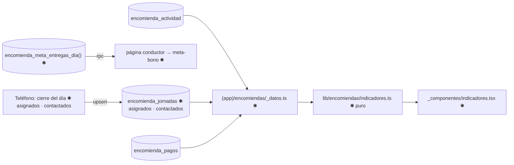

# Implementation Plan: Indicadores del negocio

**Branch**: `006-indicadores-negocio` | **Date**: 2026-10-20 | **Spec**: [spec.md](spec.md)

## Summary

Sección de indicadores en el panel (rendimiento, entregas sobre lo asignado, margen, comparación con el período anterior) calculada por una función pura sobre datos existentes, más el conteo `asignados` que envía el teléfono al cerrar y un contador de meta del bono en la app del conductor.

## Technical Context

- **Stack**: TypeScript 5, React 19.2, Next.js 16.4; sin dependencias nuevas.
- **Storage**: Postgres (+1 columna, +1 función); teléfono sin cambios de stores.
- **Testing**: `node:test`; `pruebas/esquema.mjs` y `pruebas/base.mjs` contra la base.
- **Prerrequisitos**: 002 Fase 1–2 + US1 (`encomiendas/page.tsx` dividido en `_datos.ts`, `_resumen.ts`, `_componentes/`) y 002-US2 (nombres finales); 005/007 para `asignados` real.

## Constitution Check

| Principio | Estado | Evidencia |
|---|---|---|
| I Conductor | PASS | contador de bono pasivo, offline |
| II Verdad | PASS | todo derivado de eventos registrados; margen usa tarifa congelada |
| III Pruebas | PASS | `pruebas/indicadores.test.mjs` contra cálculo manual |
| IV Externos | PASS | sin proveedores |
| V Datos | PASS | solo un conteo nuevo; la meta expuesta por función mínima |
| VI Arquitectura | PASS | diagrama y snapshot abajo |

## Diagrama (límites afectados)



## Data snapshot

| Dónde | Objeto | Cambio |
|---|---|---|
| Postgres | `encomienda_jornadas` | `asignados int null` · `contactados int null` |
| Postgres | función | `encomienda_meta_entregas_dia()` |
| Postgres | actividad, pagos, reglas | sin cambios |
| Teléfono | `enviar.ts` | envía `asignados` y `contactados` |

Detalle: [data-model.md](data-model.md) · decisiones: [research.md](research.md).

## Project Structure

```text
src/lib/encomiendas/indicadores.ts             ✱ puro: calcularIndicadores, compararPeriodos, periodoAnterior
src/app/(app)/encomiendas/_datos.ts            ✱ leer asignados y período anterior
src/app/(app)/encomiendas/_resumen.ts          ✱ usa indicadores.ts (sin duplicar KPIs existentes)
src/app/(app)/encomiendas/_componentes/indicadores.tsx   ✱ nueva sección
src/app/(app)/encomiendas/_componentes/tabla-dias.tsx    ✱ columna margen
src/lib/encomiendas/local/enviar.ts            ✱ asignados y contactados en sincronizarDiaTrabajo
src/app/(conductor)/conductor/encomiendas/page.tsx       ✱ rpc meta
src/app/(conductor)/conductor/encomiendas/_componentes/meta-bono.tsx   ✱
supabase/migrations/000N_indicadores.sql       ✱ próxima migración libre
src/types/db.ts                                ✱ DiaTrabajo.asignados · contactados
pruebas/indicadores.test.mjs                   ✱ · pruebas/esquema.mjs ✱ · pruebas/base.mjs ✱
```

**Structure Decision**: cálculo puro en `lib/encomiendas/indicadores.ts`; el panel solo carga datos y dibuja. No se toca facturación ni ingresos reales.

## Complexity Tracking

No aplica.
