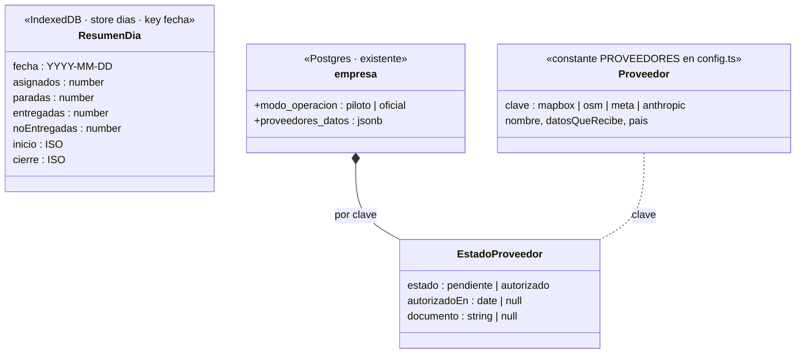

# Data Model: Cumplimiento de datos (007)

## Teléfono (IndexedDB)

| Store | Cambio |
|---|---|
| `dias` (nuevo) | `ResumenDia`. Sobrevive al día. Sin datos de personas |
| `pedidos` (con su aviso), `rutas`, `fotos` (003) | se vacían para la fecha cerrada |
| `cola` | sin cambios; se conserva hasta enviarse |

Versión: v4 (la 003 pasa a v5). `noEntregadas` de un día borrado = asignados − entregadas (lo pendiente al cerrar también vuelve). `inicio` y `cierre` permiten sincronizar el día con el servidor cuando la ruta ya no está. `STORES_DEL_DIA` lista los stores que borra el cierre; toda spec que agregue un store con datos de destinatarios lo registra ahí (003 `fotos`, 005 `lecturasPendientes`).

## Servidor (Postgres) — próxima migración libre (`000N_cumplimiento.sql`)

| Objeto | Cambio |
|---|---|
| `empresa.modo_operacion` | `text not null default 'piloto' check (in ('piloto','oficial'))` |
| `empresa.proveedores_datos` | `jsonb not null default '{}'` |
| RLS | sin cambios (lectura autenticados, escritura admin/operador) |

## Reglas

- `ResumenDia.asignados` = pedidos del día (se envía a `encomienda_jornadas.asignados` en la 006).
- Borrado = una transacción: escribir `ResumenDia` + borrar stores de la fecha.
- `proveedorHabilitado()`: piloto → sí; oficial → solo `autorizado`.
