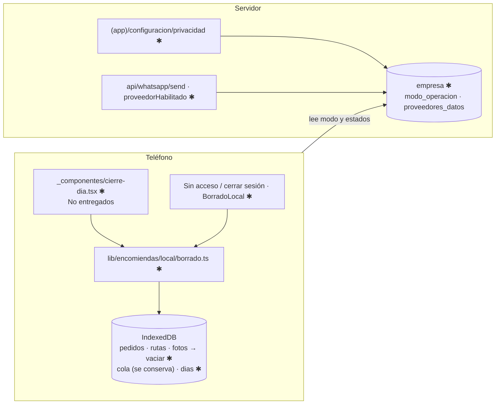

# Implementation Plan: Cumplimiento de datos (007)

**Branch**: `007-cumplimiento-datos` | **Date**: 2026-10-20 | **Spec**: [spec.md](spec.md)

## Summary

Borrado de datos de destinatarios al cerrar el día (con lista "No entregados" previa),
borrado al cerrar sesión o desactivar la cuenta, modo piloto/oficial con registro de
proveedores en `empresa`, validación de plantillas y pruebas automáticas de privacidad.
Decisiones en [research.md](research.md).

**Prerrequisito**: spec 002 Fase 1–2 + US1 (rutas `lib/auth/`, `_componentes/`, `_hooks/`).

## Technical Context

- **Stack**: TypeScript 5, Next.js 16.4, Supabase, IndexedDB; sin dependencias nuevas. 1 conductor, ≤60 pedidos/día.
- **Storage**: IndexedDB store nuevo `dias`; 2 columnas en `empresa` (próxima migración libre).
- **Testing**: `node:test` + `fake-indexeddb`; `pruebas/arquitectura.test.mjs` (002).
- **Constraints**: offline; borrado atómico; cero eventos de actividad perdidos.

## Constitution Check

| Principio | Estado | Evidencia |
|---|---|---|
| I. Conductor | PASS | Una pantalla de cierre con la lista "No entregados" |
| II. Verdad de la entrega | PASS | La cola se conserva; conteos del resumen salen de las paradas |
| III. Pruebas | PASS | `privacidad.test.mjs`, regla A10 de arquitectura |
| IV. Servicios externos | PASS | No agrega proveedores; la puerta funciona sin red |
| V. Datos y cumplimiento | PASS | Es la implementación del principio; piloto no bloqueado (v1.3.0) |
| VI. Arquitectura verificable | PASS | Diagrama y snapshot abajo; `docs/ARQUITECTURA.md` y `docs/CLASES.md` en T019 |

## Diagrama (límites afectados, ✱ = cambia)



## Snapshot de datos

| Dónde | Objeto | Cambio |
|---|---|---|
| IndexedDB | `dias` | nuevo: `ResumenDia` |
| IndexedDB | `pedidos` (con su aviso), `rutas`, `fotos` | vaciados por fecha al cerrar |
| IndexedDB | `cola` | sin cambios |
| Postgres | `empresa` | `+modo_operacion`, `+proveedores_datos` |

Detalle: [data-model.md](data-model.md).

## Project Structure

```text
specs/007-cumplimiento-datos/  spec · plan · research · data-model · quickstart · tasks · checklists/
src/
├── lib/encomiendas/
│   ├── config.ts                    ✱ PROVEEDORES, proveedorHabilitado(), validarPlantilla()
│   └── local/
│       ├── idb.ts                   ✱ store dias + STORES_DEL_DIA (v4)
│       └── almacen/borrado.ts       ✱ NUEVO noEntregadosDelDia, cerrarYBorrarDia, diasPorBorrar, borrarDatosDestinatarios
├── app/(conductor)/conductor/encomiendas/
│   ├── _hooks/use-cierre-dia.ts     ✱ NUEVO cierre → lista → borrado; días anteriores al abrir
│   └── _componentes/cierre-dia.tsx · lista-no-entregados.tsx  ✱ NUEVO
├── app/(conductor)/borrado-local.tsx ✱ NUEVO borra al confirmar el servidor que no hay acceso (R3)
├── app/(app)/configuracion/
│   ├── privacidad-form.tsx          ✱ NUEVO proveedores + modo
│   └── actions.ts                   ✱ guardarPrivacidad (puedeOperarPanel)
└── app/api/whatsapp/send/route.ts   ✱ rechaza si proveedorHabilitado("meta") es falso
supabase/migrations/000N_cumplimiento.sql   ✱ próxima migración libre
pruebas/privacidad.test.mjs                 ✱ NUEVO
pruebas/arquitectura.test.mjs               ✱ regla A10 (dominios externos)
```

**Structure Decision**: el borrado vive en un módulo del dominio local (probado sin
interfaz); las pantallas solo confirman. Los días anteriores se leen de `dias`.

## Complexity Tracking

No aplica.
