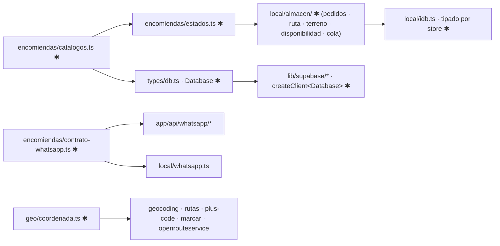

# Implementation Plan: Pulido del modelo de clases

**Branch**: `008-modelo-dominio` · **Spec**: [spec.md](spec.md)

## Summary

Refactor sin cambio de comportamiento: catálogos y máquina de estados en un lugar, tipos de
frontera honestos (Supabase, APIs, IndexedDB), almacén por agregado, modelo geo propio,
tipos derivados y nombres únicos. Cierra con un diagrama de clases esencial.

## Technical Context

- **Stack**: TypeScript 5, Next.js 16.4, supabase-js 2.112 (`GenericTable.Row` exige tipo
  con índice: las interfaces se adaptan con un tipo mapeado `Fila<T>`).
- **Testing**: 490 pruebas `node:test`, `tsc`, lint, build tras cada fase.
- **Constraints**: valores persistidos sin cambio; rutas de importación públicas estables
  (`@/lib/encomiendas/local/almacen` vía barril).

## Constitution Check

I–II PASS (sin cambios visibles; estados separados se conservan) · III PASS (suite completa
por fase; pruebas de funciones canónicas) · IV–V PASS (sin proveedores ni datos nuevos) · VI
PASS (diagrama abajo; `docs/CLASES.md` se regenera).

## Límites afectados



## Datos

| Dónde | Cambio |
|---|---|
| Postgres / IndexedDB | ninguno (mismos valores y stores) |
| `types/db.ts` | + `Database` (Tables, Functions), tipos de tabla usan catálogos |
| Tipos TS | ver tabla de movimientos |

## Movimientos y nombres

| Antes | Después |
|---|---|
| `MOTIVOS_NO_ENTREGA` (config) + `ENCOMIENDA_MOTIVOS_NO_ENTREGA` (db) | `MOTIVOS_NO_ENTREGA` en `catalogos.ts` |
| `ENCOMIENDA_ACTIVIDAD_TIPOS/_ORIGENES` (sin uso), `EventoCola.tipo` literal | `TIPOS_EVENTO`, `ORIGENES` en `catalogos.ts` |
| estado y acción WhatsApp (3 copias) | `ESTADOS_MENSAJE`, `ACCIONES_WHATSAPP` en `catalogos.ts` |
| `ENCOMIENDA_TIPO_PAGO`, `DISPONIBILIDADES` | `catalogos.ts` |
| `esReintentable` + `motivoReintentable` | `esReintentable` en `estados.ts` |
| `motivoDeEntrega`, `paradaReintentable`, `conEstadoDeResultado` | `estados.ts` (`motivoDeEntrega`, `paradaReintentable`, `estadoPedidoTras`) |
| condiciones sueltas (rechazo pendiente ×4, confirmado ×2, parada cerrada) | `rechazoPendiente`, `estaConfirmado`, `paradaCerrada` |
| `disponibilidadDeRespuesta` vs `aRespuestaDisponibilidad` | `respuestaDeAccion` en `estados.ts` |
| `Marca` (almacen) | `MarcaParada` |
| `ResultadoEnvio` (enviar / whatsapp) | `ResultadoEnvioCola` / `ResultadoEnvioMeta` |
| `esReintentable` (whatsapp.ts, HTTP) | `esErrorReintentable` |
| `METROS_PUERTA` 20 / 12 | `METROS_MISMA_PUERTA` / `PRECISION_PUERTA_M` |
| `metrosEntre` (geocoding) | `distanciaMetros` (coordenada.ts) |
| Muertos: `agregarFaltantes`, `idsGuardados`, `contarPendientes`, `rechazadosSinRegistrar`, `registrarEstadoMensaje`, `disponibilidadCerrada` | eliminados (pruebas reescritas) |

## Project Structure

```text
src/lib/encomiendas/
├── catalogos.ts            ✱ NUEVO listas cerradas
├── estados.ts              ✱ NUEVO tipos de estado + traducciones + predicados
├── contrato-whatsapp.ts    ✱ NUEVO cuerpos y respuestas de /send y /status
├── config.ts               bloques, payload de botones, VALOR_APROXIMADO_PEDIDO
├── pago.ts                 tipos derivados
└── local/
    ├── idb.ts              ✱ stores tipados
    └── almacen/            ✱ tipos · fila · migrar · pedidos · ruta · terreno · disponibilidad · cola · index
src/lib/geo/coordenada.ts   ✱ NUEVO
src/types/db.ts             ✱ Database
src/lib/supabase/*          ✱ genérico Database
```

## Complexity Tracking

No aplica.
