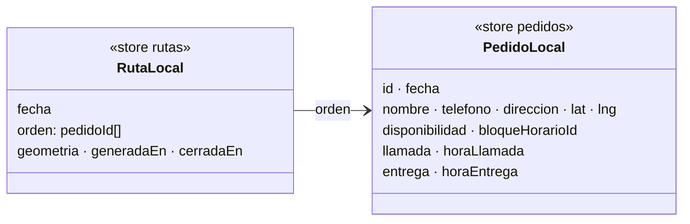

# Implementation Plan: Un pedido por día

**Branch**: `009-pedido-del-dia` · **Spec**: [spec.md](spec.md)

## Summary

Fundir `ParadaLocal` en `PedidoLocal` (un pedido = un día = una visita), dejar en la ruta solo
el orden de visita y migrar IndexedDB a v3 en la apertura.

## Technical Context

- **Stack**: TypeScript 5, Next.js 16.4, IndexedDB (`idb.ts`), `node:test` + fake-indexeddb.
- **Constraints**: transacción `versionchange` atómica para migrar; API pública del barril
  `local/almacen` estable salvo firmas que ganan `fecha`.

## Constitution Check

I–II PASS (pantalla igual; `disponibilidad` sigue separada de `entrega`) · III PASS (pruebas
de migración, fecha y rechazo) · IV PASS (todo local) · V PASS (menos datos retenidos: el día
anterior deja de usarse; el borrado sigue en 007) · VI PASS (diagrama y tabla abajo).

## Modelo



| Campo | Antes | Ahora |
|---|---|---|
| `PedidoLocal.estado` | pendiente · entregado · rechazado | se va: lo dice `entrega` |
| `PedidoLocal.fecha` | — | día de trabajo (YYYY-MM-DD, Chile) |
| `llamada`, `entrega`, `horaLlamada`, `horaEntrega` | en `ParadaLocal` | en `PedidoLocal` |
| `RutaLocal.paradas` | `ParadaLocal[]` | `orden: string[]` |
| Reglas | `paradaCerrada`, `paradaOmitida`, `paradaReintentable`, `estadoPedidoTras` | `entregaCerrada`, `entregaOmitida`, `entregaReintentable`, `rechazoPorAviso` |

## Archivos

```text
src/lib/encomiendas/
├── estados.ts               reglas renombradas; sin EstadoPedidoLocal ni estadoPedidoTras
└── local/
    ├── idb.ts               VERSION 3: migra v2 y quita el índice por_estado
    └── almacen/
        ├── tipos.ts         PedidoLocal con fecha y visita; RutaLocal.orden
        ├── migrar.ts        alDia, rutaAlDia, migrarV2 (pura, probada)
        ├── lecturas.ts      leerPedido, leerPedidos(fecha), leerRuta, pedidosEnOrden (evita el ciclo pedidos ↔ ruta)
        ├── pedidos.ts       pedidosPendientes(fecha), guardarPedido(datos, fecha, id?), borrar/restaurar
        ├── ruta.ts          guardarRuta con orden, rutaTerminada(ruta, pedidos), leerDias, resumirDia
        ├── terreno.ts       marcar sin escribir la ruta
        └── disponibilidad.ts reiniciarDisponibilidad con rechazoPorAviso
src/lib/format.ts            fechaChile(fecha)
src/app/(conductor)/conductor/encomiendas/
├── use-jornada.ts           ParadaVista = { secuencia, pedido, hayQueContactar }
├── pantalla.tsx             lee pedido.entrega / pedido.llamada
└── pedido-form-local.tsx    recibe fecha
```

## Migración v2 → v3

Por pedido, la parada del día más reciente donde aparece: copia `llamada`, `entrega`, horas y
`fecha`. Sin parada: `entrega` sale de `estado` (`rechazado` → `rechazo`) y `fecha` es hoy si
sigue pendiente, o el día de carga si no. Cada ruta: `orden = paradas.map(pedidoId)`.
