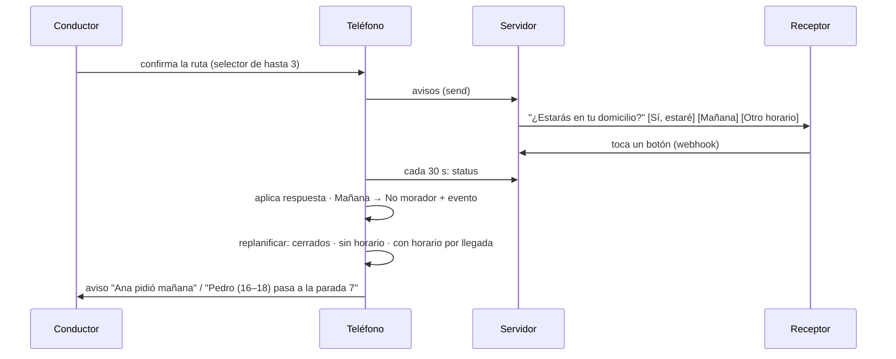

# Implementation Plan: El aviso replanifica la ruta en curso

**Branch**: `010-aviso-replanifica` · **Spec**: [spec.md](spec.md)

## Summary

El aviso sale al confirmar la ruta. Cada respuesta que llega (sondeo de 30 s) se aplica al
pedido y, si es "Mañana" u "Otro horario", reordena lo pendiente de la ruta con un cálculo de
llegada estimada compartido con el selector inicial.

## Constitution Check

I PASS (un toque del receptor; avisos al conductor) · II PASS con cambio deliberado: "Mañana"
registra No morador automáticamente; disponibilidad y resultado siguen separados y el pago
sale de eventos · III PASS (pruebas de planificador, cierre y alias) · IV PASS (sin señal se
aplica después; sin trazado queda el anterior) · V PASS (sin datos nuevos en el servidor) · VI
PASS (diagrama abajo).

## Flujo



## Modelo

| Elemento | Antes | Ahora |
|---|---|---|
| `AccionWhatsApp` | CONFIRMAR · RECHAZAR · HORARIO | CONFIRMAR · MANANA · HORARIO |
| `Disponibilidad` | 5 valores (con `rechazado`, `disponibilidad_sin_respuesta`) | `pendiente_respuesta` · `confirmado` · `horario_indicado` · `manana` |
| `RutaLocal.versionDisponibilidad` | huella sin uso en pantalla | se va |
| `Alternativa.llegariaTardeA` | solo tarde | `fueraDeHorario`: tarde o temprano |
| Etiqueta `persona_no_encontrada` | Persona no encontrada | No morador |

## Archivos

```text
src/lib/encomiendas/
├── catalogos.ts            acciones y disponibilidades nuevas; etiqueta No morador
├── config.ts               leerPayloadBoton: RECHAZAR → MANANA
├── estados.ts              respuestaDeAccion; sin rechazoPendiente / rechazoPorAviso
└── local/
    ├── planificar.ts       ✱ llegadas, minutosFueraDeBloque, ubicarConHorario (puro)
    ├── replanificar.ts     ✱ replanificarRuta(fecha, cambios) → avisos
    ├── generar-ruta.ts     "horarios" con ubicarConHorario; sin rechazados
    ├── whatsapp.ts         aplicarRespuestas(crudas, choferId) devuelve cambios
    └── almacen/
        ├── disponibilidad.ts  "manana" cierra el pedido; sin registrarRechazo
        └── ruta.ts            ordenarRuta, fijarTrazado
src/lib/whatsapp.ts         botones [CONFIRMAR, MANANA, HORARIO]
supabase/migrations/0004_aviso_manana.sql
```

## Despliegue (fuera del código)

1. Migración 0004 en Supabase (compatible con el código anterior).
2. Desplegar el código.
3. Editar la plantilla en Meta (texto y botones de `docs/WHATSAPP.md`) y esperar la aprobación.
   Gracias al orden de botones, el paso 3 puede ir antes o después del 2 sin romper nada.
