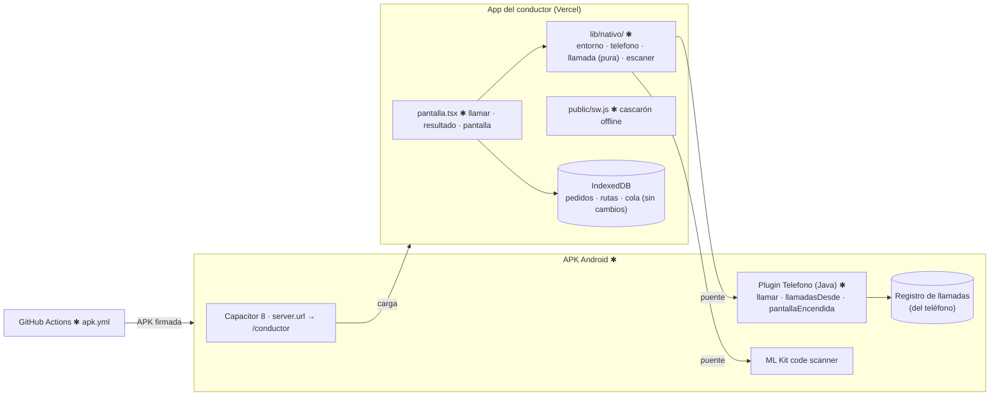

# Implementation Plan: App Android del conductor (015)

**Branch**: `015-app-android` | **Date**: 2026-10-24 | **Spec**: [spec.md](spec.md)

## Summary

APK de Capacitor 8 que carga la app del conductor publicada en Vercel y le suma un plugin propio
(`Telefono`: llamada directa, lectura del registro de llamadas, pantalla encendida), el escáner de
Google (ML Kit) y un service worker para abrir sin señal. La web decide en tiempo de ejecución si
corre dentro de la APK (`lib/nativo/`) y, si no, sigue igual que hoy. APK firmada por GitHub
Actions, instalada por archivo. Decisiones en [research.md](research.md).

**Prerrequisitos**: ninguno. Va antes que la 002 en la hoja de ruta; toca `pantalla.tsx` solo en
las llamadas y la pantalla encendida, para no chocar con su división.

## Technical Context

- **Stack**: TypeScript 5, Next.js 16.4 (web, sin cambios de despliegue); Capacitor 8
  (`@capacitor/core`, `@capacitor/android`, `@capacitor/app`, `@capacitor-mlkit/barcode-scanning`);
  Java 17 para el plugin local (la plantilla de Capacitor es Java); Android SDK 36, minSdk 24 (objetivo real Android 10+).
- **Storage**: sin cambios: IndexedDB (`pedidos`, `rutas`, `cola`) y Postgres igual. Nuevo: caché
  del service worker (`ares-conductor-v1`), solo HTML y JS de la app, sin datos de clientes.
- **Testing**: `node:test` para la regla de la llamada (`lib/nativo/llamada.ts`) y la política del
  service worker; prueba en un Android real según [quickstart.md](quickstart.md).
- **Target**: Android 10+ (teléfono del conductor) · navegador (panel y PWA) sin cambios.
- **Constraints**: 1 conductor, ≤ 60 pedidos/día; sin señal en parte de la ruta; nada del registro
  de llamadas sale del teléfono.

## Constitution Check

| Principio | Estado | Evidencia |
|---|---|---|
| I. Conductor | PASS | Llamar = 1 toque; resultado de la llamada sin tocar; pantalla encendida |
| II. Verdad de la entrega | PASS | La llamada sigue aparte del resultado; el resultado lo marca el conductor |
| III. Pruebas | PASS | `nativo-llamada.test.mjs` (regla de contestó, números, reintentos), `sw.test.mjs` |
| IV. Servicios externos | PASS | Sin permiso o sin APK, cada función vuelve a la web (FR-012) |
| V. Datos y cumplimiento | PASS | Registro de llamadas solo en el teléfono; escáner procesa en el teléfono; nota en `docs/PRIVACIDAD.md` |
| VI. Arquitectura verificable | PASS | Diagrama y tabla abajo; `docs/ARQUITECTURA.md` y `docs/CLASES.md` en T020 |
| Restricción "GPS permanente" | PASS | Ubicación solo con la app abierta; sin permiso de segundo plano |

## Diagrama (límites afectados, ✱ = nuevo o cambia)



## Snapshot de datos

| Dónde | Objeto | Cambio |
|---|---|---|
| IndexedDB | `pedidos.llamada` | sin cambio de forma; ahora también lo escribe la detección automática |
| Teléfono | registro de llamadas | se **lee** (número, fecha, duración, tipo); no se copia ni se envía |
| Navegador | Cache Storage `ares-conductor-v1` | nuevo: HTML de `/conductor` y `/_next/static/*` |
| Vercel | `APK_VERSION_MINIMA`, `APK_URL` | variables nuevas (servidor) |
| Android | permisos | `CALL_PHONE`, `READ_CALL_LOG`, `ACCESS_FINE_LOCATION`, `INTERNET` |
| Postgres | — | sin cambios |

Detalle en [data-model.md](data-model.md); contrato del puente en
[contracts/nativo.md](contracts/nativo.md).

## Project Structure

```text
specs/015-app-android/   spec · plan · research · data-model · contracts/nativo.md · quickstart · tasks

capacitor.config.ts                 ✱ appId cl.pucarani.ares · server.url · errorPath
capacitor/www/sin-senal.html        ✱ página local si no hay red en el primer arranque
android/                            ✱ proyecto generado por `npx cap add android` (se versiona)
└── app/src/main/
    ├── AndroidManifest.xml         ✱ permisos
    └── java/cl/pucarani/ares/
        ├── MainActivity.java       ✱ registra TelefonoPlugin
        └── TelefonoPlugin.java     ✱ llamar · llamadasDesde · pantallaEncendida
.github/workflows/apk.yml           ✱ build y firma
public/sw.js                        ✱ service worker (alcance /conductor)
src/lib/nativo/
├── entorno.ts                      ✱ esApp(), versión instalada
├── telefono.ts                     ✱ llamar(), llamadasDesde(), pantallaEncendida() con respaldo web
├── llamada.ts                      ✱ resultadoDeLlamada() — pura
└── escaner.ts                      ✱ escanearCodigo() (lo usa la 005)
src/app/(conductor)/
├── layout.tsx                      ✱ registra el service worker
└── conductor/encomiendas/
    ├── page.tsx                    ✱ pasa versión mínima y URL de la APK
    ├── pantalla.tsx                ✱ llamar nativo, corrección, "Llamar a X", pantalla encendida, aviso de versión
    └── use-llamada-nativa.ts       ✱ al volver a primer plano, decide y marca la llamada
pruebas/nativo-llamada.test.mjs · pruebas/sw.test.mjs   ✱
```

**Structure Decision**: web + `android/` en el mismo repositorio; el código de la app sigue en
`src/` y la parte nativa queda aislada en `android/` y `src/lib/nativo/`.

## Complexity Tracking

| Violación / desvío | Por qué | Alternativa descartada |
|---|---|---|
| `server.url` en producción (Capacitor no lo recomienda) | La app usa páginas de servidor, Server Actions y `/api`; no se puede empaquetar sin reescribirla | Build estático + Live Updates: reescribir la app del conductor como SPA (tamaño de la 002) |
| Plugin nativo propio | No hay plugin mantenido para el registro de llamadas | Plugins de terceros sin mantención o solo "llamar" |
