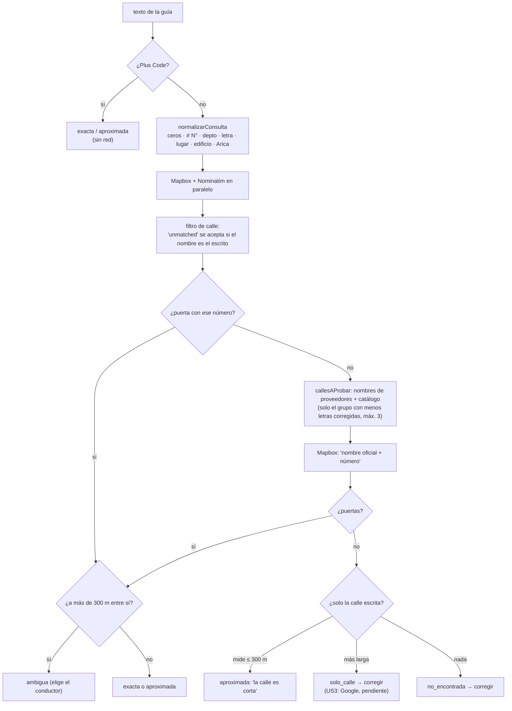

# Plan · Spec 016

## Flujo de `ubicarDireccion` (`src/lib/geo/geocoding/ubicar.ts`)



## Módulos

| Archivo | Qué | Red |
|---|---|---|
| `geo/geocoding/consulta.ts` | `normalizarConsulta`, `partirCalleYNumero`, `palabrasDe`, `coincidenciaCalle`, `esLaCalleEscrita`, `distanciaEdicion` | no |
| `geo/geocoding/calles.ts` | `callesParecidas(escrito)`, `largoDeCalle(nombre)`; carga el catálogo la primera vez (import dinámico) | no |
| `geo/geocoding/calles-arica.ts` | **generado** por `scripts/generar-calles.mjs` (`npm run calles`); 1.563 calles, ~31 KB | no |
| `geo/geocoding/{mapbox,nominatim}.ts` | los dos proveedores | Mapbox, Nominatim |
| `geo/geocoding/completar-numero.ts` | `completarNumeroEnCalles` (usa `callesAProbar`), `aplicarPuertas`, `combinarSugerencias` | Mapbox |
| `geo/geocoding/ubicar.ts` | `ubicarDireccion`, `geocodificarDireccion` (desde la 002 T033; antes todo estaba en `index.ts`) | — |

## Datos

```text
calles-arica.ts   una calle por línea:  nombre | largo en metros | otros nombres (;)
                  "Carlos Witting|135|"   "Avenida Alejandro Azola|5162|"
                  largo = diagonal del recuadro de TODOS los tramos con ese nombre
                  (dos homónimas lejanas suman un largo grande → nunca "calle corta")

Coincidencia      { ediciones, faltantes, sobrantes }   orden: ediciones → faltantes → sobrantes
                  "Braulio Muniz" ↔ "Braulio Muñoz"           { 1, 0, 0 }
                  "Santiago Arata" ↔ "Santiago Arata Gandolfo" { 0, 0, 1 }
CalleParecida     Coincidencia + { nombre, largo }
ResultadoUbicacion  sin cambios (tipo · candidatos · elegida · advertencia)
```

Nada se guarda: el catálogo es público (OSM, licencia ODbL, atribución en la cabecera del
archivo) y viaja con el código. Overpass solo recibe el recuadro de Arica al regenerarlo.

## Decisiones

- **Catálogo en el código y no más consultas**: corrige sin red, se prueba sin dobles y no gasta
  turnos de Nominatim (1 por segundo). Costo: regenerarlo cuando haya calles nuevas.
- **Topes de corrección por largo de palabra**: "Linder" no es "Linderos" (2 letras), "Lebo" no
  es "Lebu" (palabra corta). El grupo con menos correcciones manda: "Maipu" no trae "Maipo" si
  existe "Maipú".
- **300 m** para calle corta y para ambigüedad: más que una cuadra de Arica.
- **Mapbox `street: unmatched`**: se reemplaza su juicio por `esLaCalleEscrita`. Cubre el caso
  "Diego Portales" (otra calle, se descarta) y "Alejandro Azolas" (misma calle, se usa).

## Google (US3, pendiente)

Lo que queda sin ubicar son calles largas que **ningún proveedor abierto tiene numeradas**; ahí
solo Google tiene la puerta. Antes de integrarlo, el dueño decide:

1. **Términos**: Google Maps Platform no permite usar sus resultados con un mapa que no sea de
   Google. ARES dibuja y rutea con Mapbox. Opciones: aceptar el riesgo, o usar Google solo para
   que el conductor vea el punto en un mapa de Google y lo marque él (más pasos).
2. **Costo**: clave con facturación (Geocoding: cupo mensual gratis; ~60 direcciones/día y
   solo las que fallan quedan muy por debajo).
3. **Privacidad**: Google recibiría direcciones → fila en `docs/PRIVACIDAD.md`.

Si se aprueba: `geo/geocoding/google.ts` (solo con `GOOGLE_MAPS_KEY`), llamado únicamente cuando
el resultado es `solo_calle` o `no_encontrada`, y su puerta validada con `esLaCalleEscrita`.
