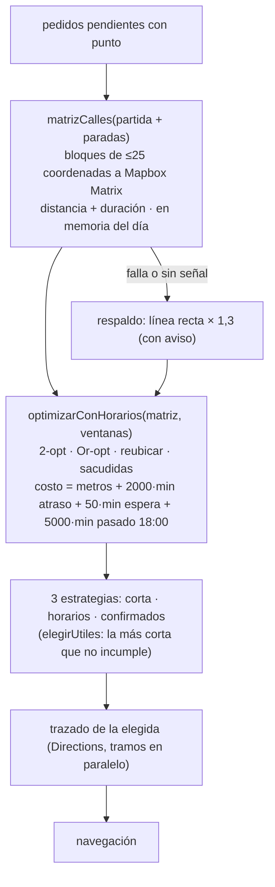
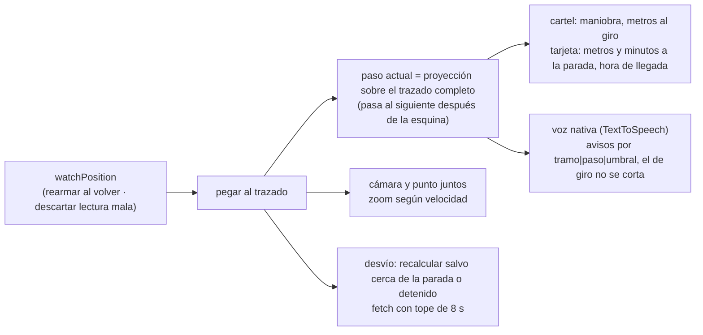

# Plan · Spec 017

## Ruta del día (R1–R5)



## Navegación (N1–N12)



## Estructuras

```text
MatrizCalles   { metros: number[][]; completa: boolean; pedidos: number }
               | { metros: null; motivo: "sin_token" | "cupo" | "sin_respuesta" }
               pares en memoria (Map por par de puntos a ~1 m); se pierde al recargar — no se
               guarda: son puntos de destinatarios. Solo distancia: el tiempo sale del reloj de
               planificar.ts (25 km/h + 4 min por parada), el mismo que mide y avisa.
ParadaPlan     { id; punto; ventana: { desde, hasta } | null (minutos del día); servicioMin }
CostoPlan      { metros; minutosAtraso; minutosEspera; minutosPasado18 }
EstadoTramo    { tramoId; paso; metrosAlGiro; metrosRestantes; segundosRestantes; llegada: Date }
Voz            { hablar(texto, prioridad: "giro" | "aviso"); callar() } → lib/nativo/voz.ts
```

## Decisiones

- Matriz por bloques en Mapbox (no grafo propio en el teléfono por ahora): 61 puntos ≈ 25
  consultas y 3.721 elementos por armado; rehacer la ruta con los mismos pedidos no vuelve a
  consultar. El grafo de Arica en el teléfono queda como mejora futura (sin costo, sin señal).
- El optimizador con horarios reemplaza el "insertar de a uno" de `planificar.ts` para la
  estrategia "horarios"; "corta" sigue siendo el optimizador sin ventanas.
- Voz: método `hablar` en el plugin propio `Telefono` (TextToSpeech de Android), con la voz
  del navegador fuera de la APK. Requiere reinstalar la APK (sube `APK_VERSION_MINIMA`).
