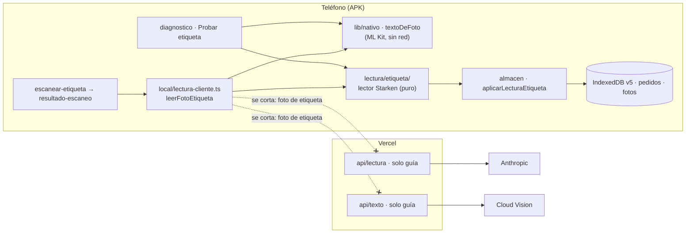

# Plan 021 · Lector de etiquetas en el teléfono

Spec: [spec.md](spec.md) · Tareas: [tasks.md](tasks.md). Constitución III (pruebas de privacidad),
V (datos mínimos) y VI (diagrama y datos).

## 1. Límites que cambian

Fuera de la APK, `textoDeFoto` devuelve `null`: se pega el texto y pasa por el mismo lector.

## 2. Datos

| Dónde | Qué | Cambio |
|---|---|---|
| Postgres | — | ninguno |
| IndexedDB (`dashund-encomiendas` v5) | `pedidos` (nombre, telefono, direccion, porPagar, montoPorPagar, bultos, referencia, fotoId) y `fotos` | ninguno: se llenan los mismos campos, desde otro lector |
| Tipo `LecturaEtiqueta` | lo que devuelve el lector | igual, y suma `formato: FormatoEtiqueta`, que no se guarda (sirve para el diagnóstico y las pruebas) |
| Tipo `RespuestaLectura` (`contrato.ts`) | respuesta de `/api/lectura` | pierde la variante `etiqueta` |
| Tipo `EtiquetaIA` (`esquemas.ts`) | salida estructurada de Claude | se borra, igual que `etiquetaDesdeIA` y `conDescripcion` |
| `LecturaFoto` / `FuenteLectura` (`lectura-cliente.ts`) | quién leyó la foto | la etiqueta siempre es `"texto"` |
| Variable `LECTURA_MODELO` | modelo de las etiquetas | se borra de `.env.example` y de Vercel (la borra el dueño) |

**Docs que hoy no coinciden con el resultado** (se corrigen en T010):
- `docs/PRIVACIDAD.md` §3: en las filas de Anthropic y Cloud Vision dice «fotos de guía y
  etiquetas».
- `docs/ARQUITECTURA.md` §1: las flechas «foto de etiqueta o guía» y «foto que el teléfono no pudo
  leer».
- `docs/CLASES.md` §4: la fila de «Lectura de una foto».
- `AGENTS.md`, «Foto de la etiqueta»: «con la IA encendida, también la IA».
- `docs/HOJA-DE-RUTA.md`: la fila 005 y la tabla de datos.
- Spec 005, T030: ya no elige modelo.

## 3. El lector (`src/lib/encomiendas/lectura/etiqueta/`)

`etiqueta.ts` pasa a ser una carpeta. El import `@/lib/encomiendas/lectura/etiqueta` sigue valiendo
gracias a `index.ts`. Todos los archivos son puros, sin red ni `idb`, y cada uno tiene menos de
~200 líneas.

| Archivo | Qué hace |
|---|---|
| `index.ts` | `leerEtiqueta(texto)`, `etiquetaCompleta`, `pagoDe` y los tipos. Es la única entrada |
| `formatos.ts` | el diccionario: palabras clave por campo y marcas de cada formato. **Es lo único que se toca para sumar un formato** |
| `normalizar.ts` | renglones limpios. Una copia para comparar (sin tildes, en mayúsculas, con O↔0, I↔1, S↔5 dentro de las palabras clave) y el original para los valores |
| `zonas.ts` | asigna cada renglón a la zona `destinatario`, `remitente` o `general`, según el último ancla visto |
| `campos.ts` | un extractor por campo: teléfono, nombre, dirección, pago, monto, bultos y OF impresa |
| `anonimizar.ts` | para US3: cambia letras y dígitos de los valores, deja las palabras clave y mantiene el largo |

**Pasos de `leerEtiqueta`:**
1. **Renglones.** Se separa por `\n`, se recorta y se descartan los vacíos.
2. **Formato.** Se detecta por las marcas de `formatos.ts` (`starken`, `expres`, `lion`, y si no,
   `desconocido`). El formato solo elige variantes del diccionario: el lector funciona igual con
   `desconocido`.
3. **Zonas.** Un ancla de destinatario (DESTINATARIO y sus variantes) o de remitente (REMITENTE y
   sus variantes) abre su zona hasta el ancla siguiente. Las variantes se confirman con los ejemplos
   del dueño. «DESTINO» puede ser la ciudad o la agencia, así que no es ancla hasta verlo en un
   ejemplo. Lo que viene antes del primer ancla es `general`.
4. **Campos:**
   - **Teléfono.** Primero se arman los candidatos: celular `(+?56)? 9 XXXX XXXX` y fijo de Arica
     `(+?56)? 58 XXX XXXX`, con espacios, puntos o guiones, y validados con `normalizarTelefono`. Se
     excluyen los dígitos que forman parte de la secuencia de 26 que empieza con 92, la OF impresa,
     un RUT (`\d{1,2}.?\d{3}.?\d{3}-[\dkK]`) y lo que va después de `$`. Después se elige por orden
     de prioridad:
     1. Detrás de Tel / Teléfono / Fono / Cel / Celular / Móvil, dentro de la zona del destinatario.
     2. Cualquiera en la zona del destinatario.
     3. Cualquiera en la zona `general`.

     **Nunca se toma uno de la zona del remitente.** Si en la misma prioridad hay dos teléfonos
     distintos, se usa el primero y queda como dudoso.
   - **Nombre.** Es lo que sigue al ancla de destinatario en el mismo renglón o, si no hay nada, el
     siguiente renglón que no sea una palabra clave, un teléfono, un RUT ni algo con número. Si lleva
     dígitos o tiene menos de 3 letras, queda como dudoso.
   - **Dirección.** Lo que sigue a DIRECCIÓN / DOMICILIO / DIR. dentro de la zona del destinatario.
     Solo sirve para compararla con la guía (`direccionDistinta`) y nunca reemplaza la dirección sola.
   - **Pago.** POR PAGAR / PAGO EN DESTINO → `POR_PAGAR`. CONTADO → `CONTADO`. CTA CTE / CUENTA
     CORRIENTE → `CTA_CTE`. Si aparecen dos tipos distintos, el pago es `DESCONOCIDO` y queda como
     dudoso. Las variantes se confirman con los ejemplos.
   - **Monto.** Solo cuenta con POR PAGAR. Se toma de «Total Monto O.F.» (con O o 0) y, si no está,
     del `$ n` del renglón de POR PAGAR o del siguiente. Si es 0 o no se encuentra, queda en `null`
     y como dudoso.
   - **Bultos y OF impresa.** Las mismas expresiones de hoy.
5. **Dudosos.** Se agregan con la misma regla de hoy, y `etiquetaCompleta` no cambia.

## 4. Lo que cambia fuera del lector

- **`local/lectura-cliente.ts`.** `leerImagen("etiqueta")` pasa a ser `leerFotoEtiqueta(foto)`:
  comprime la foto, la lee con `textoDeFoto` y pasa el texto a `leerEtiqueta`. No tiene rama de IA
  ni llama a `textoEnLaNube`. Si no sale texto, lanza `ErrorLectura` 422 con la salida de pegar el
  texto. El camino de la guía no se toca.
- **Pantalla.** `resultado-escaneo.tsx`, `escanear-etiqueta.tsx` y `ventanas-pantalla.tsx` dejan de
  recibir `lecturaIA`. El botón de foto aparece solo con `esApp()`. Si la etiqueta no trae
  descripción, ¿se abre solo el selector de tres toques después de la foto? Se decide con una
  maqueta (AGENTS: «En cambios de diseño…»). Si cambia el nombre de un botón, se cambia también
  `ayuda.tsx`.
- **Servidor.**
  - `api/lectura/route.ts` acepta solo `tipo=guia` y contesta 400 a lo demás.
  - En `lectura/servidor.ts` se borran las instrucciones de la etiqueta, `MODELO_POR_DEFECTO` y la
    rama de `EtiquetaIA`.
  - En `esquemas.ts` se borra `EtiquetaIA`.
- **Diagnóstico.** `conductor/diagnostico/page.tsx` agrega la sección «Probar etiqueta» (US3). Si la
  página pasa de ~400 líneas, la sección va a un componente propio.

## 5. Plan B: posiciones de ML Kit (solo si los ejemplos lo piden)

Puede que en un formato con columnas ML Kit mezcle la zona del destinatario con la del remitente.
La prueba es un fixture de ML Kit que falla aunque el diccionario esté completo. Si pasa:
- `leerTexto` devuelve también `lineas: [{ texto, x, y, ancho, alto }]` (`TextBlock.getLines()`).
- `leerEtiqueta` acepta las líneas y arma las zonas por cercanía en vez de por orden.

Esto cambia `android/`, así que se pregunta antes: obliga a recompilar la APK y a subir
`APK_VERSION_MINIMA`. Una APK vieja, que no trae `lineas`, sigue con el texto.

## 6. Pruebas (constitución III)

- **`pruebas/lectura-etiqueta.test.mjs`** (nueva, sin red). Cubre:
  - un caso por fixture de formato;
  - el teléfono del remitente que nunca se toma;
  - un celular sin «Tel.»;
  - dos teléfonos → dudoso;
  - errores del lector en las palabras clave;
  - POR PAGAR sin monto y el monto en el renglón siguiente;
  - CONTADO con monto → no se cobra;
  - que no se extraiga RUT, remitente ni correo;
  - `anonimizar` mantiene las palabras clave y no deja ningún dígito ni palabra del valor original.
- **`pruebas/lectura.test.mjs`.** La sección de etiqueta se mueve a la prueba nueva. La de la guía
  queda donde está.
- **`pruebas/lectura-servidor.test.mjs`.** Las pruebas de la etiqueta pasan a ser una sola:
  `tipo=etiqueta` → 400, sin llamar a Anthropic (con `fetch` reemplazado).
- **`pruebas/descripcion-etiqueta.test.mjs`.** Prueba `conDescripcion`, que se borra. Antes de
  borrar el archivo se pregunta (AGENTS, Límites).
- **Privacidad (SC-001).** Una prueba estática en `privacidad.test.mjs`: el camino de la etiqueta en
  `lectura-cliente.ts` no nombra `/api/lectura` ni `/api/texto`.
- **Fixtures.** Van en `pruebas/fixtures/lectura/etiqueta-<formato>.txt`, con el texto **tal como lo
  lee ML Kit** (sale de US3) y datos inventados: calles reales con número, nombre y teléfono
  inventados. Antes de agregarlos se revisa que no quede ningún dato real.

## 7. Recorrido para verificar (en la APK, en modo prueba)

1. Cargar una guía de prueba, armar la ruta y tocar «Escanear los paquetes». Se escanea el código
   de barras de una etiqueta inventada.
2. «Foto de la etiqueta», con la cámara, de a una foto. Tienen que salir el nombre, el teléfono y el
   POR PAGAR con su monto, sin señal (modo avión). En `chrome://inspect` → Network no tiene que
   aparecer ninguna consulta.
3. Repetir con cada formato: Starken, EXPRES, Lion y los del dueño.
4. Foto de la etiqueta de **otro** paquete: «La foto es de la OF … no se usó».
5. Una etiqueta sin monto en un POR PAGAR: «monto por revisar».
6. Describir el paquete con tres toques y confirmar que la parada lo muestra.
7. En el navegador (sin la APK): no hay botón de foto, y pegar el texto completa lo mismo.
8. Diagnóstico → «Probar etiqueta» → «Copiar anonimizado»: el texto copiado no tiene ningún dato de
   la foto.
