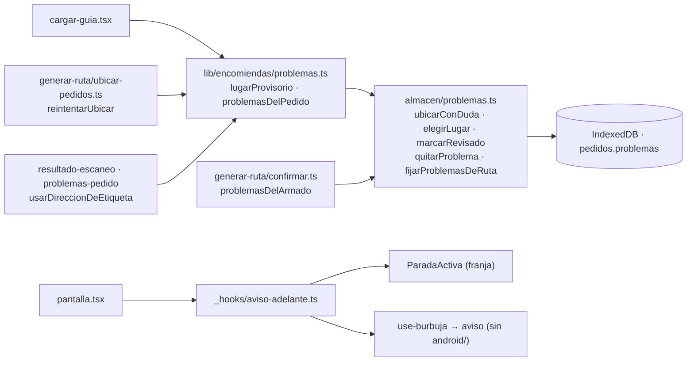

# Plan 022 · Pedidos con problemas (⚠) dentro de la ruta

Spec: [spec.md](spec.md). Solo el teléfono: nada nuevo sale de él, sin proveedores nuevos, sin
migraciones, sin tocar `android/` (la burbuja recibe el texto en su línea de aviso, que ya existe).

## Límites afectados

## Datos

| Dato | Dónde | Cambio |
|---|---|---|
| `Pedido.problemas: ProblemaGuardado[]` | Teléfono · store `pedidos` | **Nuevo**, sin índice ni versión nueva de `idb.ts` (un campo no la sube); los de antes se leen `[]` (`alDia`). Se borra con el día (`STORES_DEL_DIA`). Las opciones de lugar son puntos y textos de la búsqueda: no salen del teléfono |
| `ProblemaGuardado`, `OpcionLugar`, `TipoProblema` | `lib/encomiendas/problemas.ts` | **Nuevos** tipos; la OF de otro largo sale de `TipoProblema` |
| `Alternativa.fueraDeHorarioIds` | `generar-ruta/tipos.ts` (memoria) | **Nuevo**: los ids, además de los nombres |
| `guardarPedido(…, nuevo?)` | `almacen/pedidos.ts` | Nuevo parámetro opcional: origen y ⚠ de uno nuevo (fuera de la guía) |
| `ofDistinta` | `lib/encomiendas/paquete.ts` | **Sale** (sin uso) |

Trampas cuidadas: `guardarPedido` arma el pedido campo por campo (conserva `problemas` a mano) y
`crearDesdeGuia` lleva `problemas: []`.

## Pruebas (constitución III: rutas y direcciones)
- `problemas.test.mjs`: deducidos, guardados, revisados, OF de otro largo sin ⚠, `lugarProvisorio`.
- `pedidos-con-problemas.test.mjs`: almacén real; `avisoAdelante`; `problemasDelArmado`.
- `asistencia-rutas.test.mjs`: la lejana queda en el pedido y «Va igual» se conserva; la ruta del
  caché no pierde avisos.
- `carga.test.mjs` y `3-almacen.test.mjs` siguen en verde.
- Pantalla: a mano a 360 px (`quickstart.md`). La burbuja, en la APK (T010).
