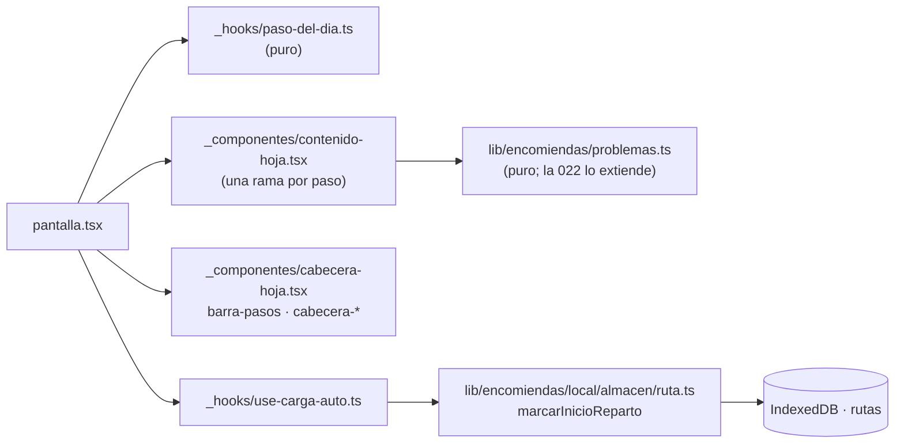

# Plan 027 · La hoja de ARES, paso por paso

Spec: [spec.md](spec.md). Solo la app del conductor: nada nuevo sale del teléfono, sin proveedores
ni migraciones, sin tocar `android/`.

## Límites afectados

- `paso-del-dia.ts` decide el paso: `guia` · `resolver` · `ruta` · `carga` · `reparto` · `cierre`.
- `use-carga-auto.ts` junta el avance de la carga (`avanceCarga`, `sinEtiquetaEscaneada`), si
  terminó, «Salir a repartir» y la marca automática al escanear todo.
- `cabecera-hoja.tsx` elige la cabecera; la del reparto sigue siendo `ParadaActiva` (spec 020).
- `use-resolver-problemas.ts`: «Resolver los ⚠» abre de a uno en la hoja (`VistaPedido` con «⚠ n de N»).
- `useCierreDia.reabrir`: «Cerrar el día» vuelve a abrir el cierre aplazado.
- Se van `aviso-cargar-auto.tsx` (la ventana «Ruta lista») y `progreso-carga.tsx` (pasa a ser la
  lista «Faltan»).

## Datos

| Dato | Dónde | Cambio |
|---|---|---|
| `Ruta.inicioReparto: string \| null` (opcional) | Teléfono · store `rutas` | **Nuevo.** Cuándo salió a repartir. Sin índice ni versión nueva de `idb.ts`; una ruta guardada antes lo lee `undefined` = `null`. `guardarRuta` lo conserva; no se manda al servidor (`sincronizarDiaTrabajo` manda `inicio` y `cierre`) |
| `Pedido` (`lat`, `lng`, `of`) | Teléfono · store `pedidos` | Solo se lee: `problemasDelPedido` deduce sin ubicar, OF distinta y sin OF |
| `ProblemaPedido` | `lib/encomiendas/problemas.ts` | **Nuevo tipo**, sin guardar. La 022 le suma los que se guardan |
| `Paso` | `_hooks/paso-del-dia.ts` | **Nuevo tipo**, de pantalla |

Docs en el mismo cambio: `docs/CLASES.md` (`Ruta.inicioReparto`, `problemas.ts`, el paso) y
`docs/ARQUITECTURA.md` (store `rutas`).

## Pruebas (constitución III: estados de entrega)

- `pantalla-conductor.test.mjs`: `pasoDelDia`, un caso por paso y los bordes de la spec.
- `problemas.test.mjs`: sin ubicar, OF distinta (con el largo), sin OF, y sin problema.
- `3-almacen.test.mjs`: `marcarInicioReparto` escribe una vez y `guardarRuta` lo conserva.
- Pantalla: a mano a 360 px en modo prueba (`quickstart.md`, skill `recorrer-conductor`).
