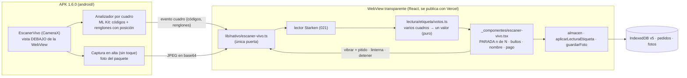

# Plan 028 · Escáner de etiquetas en vivo

Spec: [spec.md](spec.md) · Tareas: [tasks.md](tasks.md). Constitución I (menos toques), III
(pruebas), V (datos mínimos) y VI (diagrama y datos). Sale de la rama de la
[021](../021-lector-etiquetas/plan.md), que deja el lector de etiquetas en el teléfono.

## 1. Límites que cambian

- Ni los cuadros ni la captura salen del teléfono: no hay flecha a la red (SC-004).
- La cámara va debajo de la WebView y no en una Activity aparte: la WebView sigue al frente (no se
  congela a los ~60 s, spec 020) y toda la lógica queda en la web, probada con `node:test`.
- Mismo patrón que `startScan` de `@capacitor-mlkit/barcode-scanning` (Apache-2.0): `PreviewView`
  en el índice 0 del padre de la WebView y la WebView transparente mientras escanea.
- Fuera de la APK, o con una APK anterior a la 1.6.0, queda el escaneo de hoy (escáner de Google +
  «Foto de la etiqueta»).

## 2. Datos

| Dónde | Qué | Cambio |
|---|---|---|
| Postgres | — | ninguno |
| IndexedDB (`dashund-encomiendas` v5) | `pedidos` (nombre, teléfono, pago, monto, bultos) y `fotos` | ninguno: se llenan igual que con la foto (`aplicarLecturaEtiqueta`, `guardarFoto`) |
| Tipo nuevo `CuadroVivo` (`lib/nativo/escaner-vivo.ts`) | `{ codigos: string[]; renglones: { texto; x; y; ancho; alto }[]; ms }` | en memoria, no se guarda |
| Tipo nuevo `Votos` (`lectura/etiqueta/votos.ts`) | las lecturas de una OF mientras está en cámara | en memoria; se olvida al cambiar de etiqueta |
| `LecturaEtiqueta` (021) | lo que entiende el lector | igual |
| `android/` | `EscanerVivoPlugin.java` (nuevo), permiso `CAMERA` y `VIBRATE`, versión 1.6.0 (código 10) | **pregunta hecha**: el dueño eligió la 028 sabiendo que toca `android/` |

Dependencias: ninguna nueva. CameraX 1.5.2 y ML Kit (códigos 17.3.0, texto 16.0.1) ya vienen en la
APK; se declaran en `android/app/build.gradle` con las mismas versiones.

## 3. El plugin nativo (`android/…/EscanerVivoPlugin.java`)

| Método / evento | Qué hace |
|---|---|
| `iniciar()` | pide `CAMERA` si falta, pone la vista de la cámara debajo de la WebView y arranca el análisis (cuadros de 1920×1080, solo el último: `STRATEGY_KEEP_ONLY_LATEST`) |
| evento `cuadro` | por cada cuadro analizado: los códigos que vio y los renglones de ML Kit con su caja (`Line.getBoundingBox()`), y cuánto tardó |
| `capturar()` | una foto en alta (`ImageCapture`) → JPEG en base64: la foto del paquete y una lectura más fina |
| `linterna({ encendida })` | `CameraControl.enableTorch` |
| `avisar()` | vibración corta + pitido (`ToneGenerator`) |
| `detener()` | apaga la cámara y devuelve el fondo de la WebView |

- Ningún dato de un cuadro va al log nativo. Ojo: la APK de **depuración** de Capacitor registra en
  logcat lo que pasa por el puente (MEMORY, spec 020); la firmada no. Se anota en `PRIVACIDAD.md`.
- Base: el stash «028 escáner en vivo…» (lectura nativa de códigos + texto de una imagen, que sirve
  para `capturar`) y `codigoEnLaFoto` (elige el código de Starken entre los que se ven).

## 4. La web

- **`lib/nativo/escaner-vivo.ts`**: envuelve el plugin (única puerta a `@capacitor/*`), con
  `disponible()` según la versión de la APK.
- **`lectura/etiqueta/votos.ts`** (puro): junta los cuadros de una misma OF.
  - La OF y el bulto, del código de Starken del cuadro (`codigoEnLaFoto`); nunca del texto.
  - Cada cuadro pasa por el lector (021); un campo queda **firme** cuando sale igual en ≥ 2 cuadros
    (o en la captura en alta y un cuadro). Lo que se contradice queda por revisar, igual que
    `combinarLecturas`.
  - Una etiqueta nueva (otra OF) reemplaza a la anterior.
- **Pantalla** (`_componentes/escaner-vivo.tsx`, reemplaza a `escanear-etiqueta` en la APK 1.6.0):
  - Arriba, el contador `x/N` y la linterna; al medio, la cámara; abajo, el panel: «PARADA n de N»
    en lo más grande, bultos, nombre, teléfono y pago (maqueta aprobada en la spec). «Escribir la
    OF» siempre a la vista.
  - Al leer el código: la parada, de inmediato. Cuando la etiqueta queda leída (campos firmes, o a
    los 4 s con lo que haya y su ⚠): `avisar()`, `capturar()` y se guarda todo. La misma etiqueta
    no vuelve a avisar mientras siga en cámara.
  - Un ⚠ (no está en el día, dirección distinta, más bultos): el análisis se pausa y se muestra el
    aviso con sus botones de hoy; al resolverlo, sigue.
- **Lector por posición** (plan B de la 021): `leerEtiqueta` acepta también los renglones con su
  caja y arma las zonas por cercanía (lo que está a la derecha o debajo de «DESTINATARIO»). Se hace
  después de medir (T003), si el orden de ML Kit en vivo lo pide.

## 5. Primero, medir (T003, antes de la pantalla)

Diagnóstico → «Probar escáner en vivo»: la cámara y, por cada cuadro, los códigos, cuántos
renglones, los ms y lo que entendió el lector; no guarda nada. En el V2430 con las tres etiquetas
reales (Lion, Starken normal, EXPRES) se mide:
- si la letra chica se lee en cuadros de 1920×1080, y cuántos cuadros hacen falta para que el
  teléfono, el nombre y el pago queden firmes;
- cuánto tarda cada cuadro.

Si en vivo no alcanza, queda el **plan B** de la spec: el código en vivo y, apenas aparece, la
captura en alta para el texto (sigue sin toques).

## 6. Pruebas (constitución III)

- `pruebas/votos-etiqueta.test.mjs` (nueva, sin red): firme con 2 cuadros iguales, contradicción →
  por revisar, el pago nunca se adivina, otra OF reinicia, la OF solo del código.
- `pruebas/escaner-vivo.test.mjs`: el envoltorio con el puente de Capacitor simulado (como
  `etiqueta-en-el-telefono.test.mjs`): sin red, y con una APK anterior no se ofrece.
- Privacidad: prueba estática de que `escaner-vivo.ts` y el componente no usan `fetch` ni `/api/`.
- Lo nativo se prueba en el teléfono (APK de prueba al lado de la firmada, skill `apk-local`).

## 7. Recorrido (en la APK de prueba, modo prueba)

1. Diagnóstico → «Probar escáner en vivo» con las tres etiquetas reales: anotar cuadros y ms.
2. Cargar una guía de prueba con las OF de esas etiquetas → «Cargar el auto».
3. Pasar las etiquetas una tras otra, sin tocar: vibra, pita, «PARADA n de N», nombre, teléfono y
   pago correctos; la foto del paquete queda en la parada.
4. Linterna; una etiqueta que no está en el día (⚠ y sigue); la misma etiqueta dos veces (no suma).
5. Modo avión: todo igual. Vigilante de red: ninguna consulta durante el escaneo.
6. Sin permiso de cámara: se pide una vez; si se niega, queda el escaneo de hoy.
